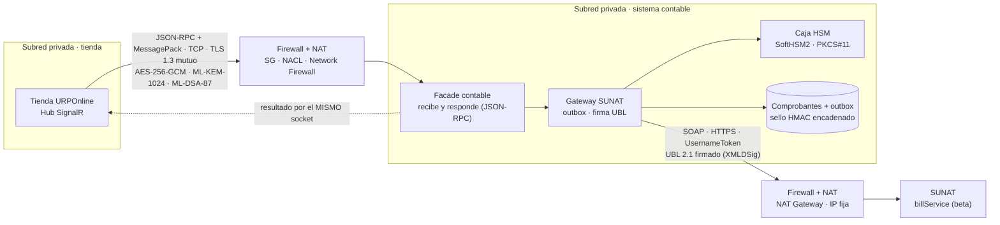
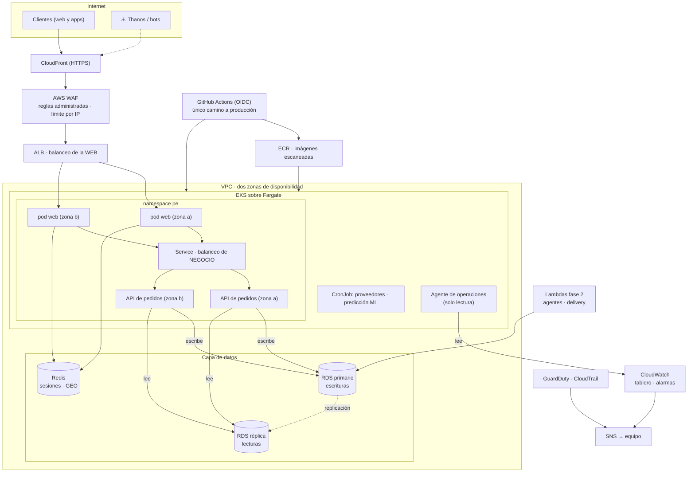
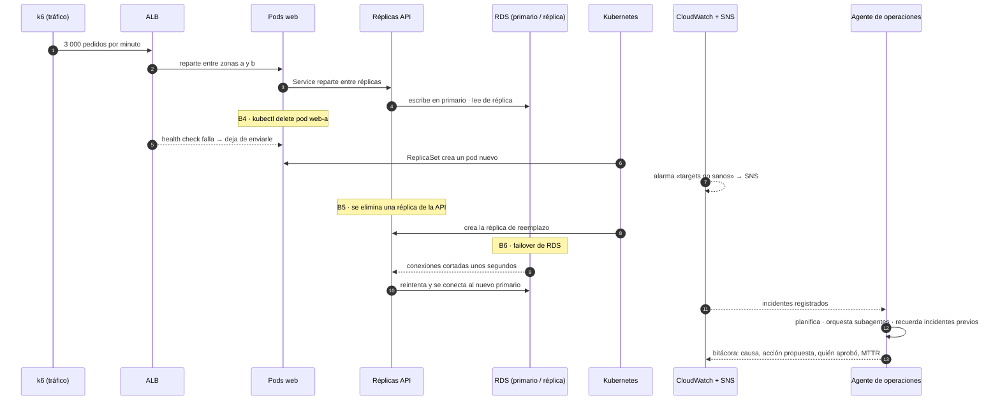

# URPOnline — Laboratorio AWS (TiendaOnline .NET)

> **Fase 3:** 21 de noviembre

---

# 🧑‍🤝‍🧑 PRIMERO: CREA EL REPOSITORIO DE TU GRUPO. TRABAJA SOLO EN ÉL

Este repositorio del curso es **solo de lectura**: aquí no puedes subir cambios ni desplegar. Cada grupo crea **su propio repositorio**, sube ahí una copia del laboratorio y trabaja solo en él: ahí corren **sus** GitHub Actions contra **su** cuenta de AWS, y ese repositorio es el que se evalúa.

1. Acepta la invitación que te llegó al correo de la universidad (o entra a https://github.com/orgs/cortexgovernor/invitation): sin ella no puedes clonar el laboratorio.
2. **Un integrante crea el repositorio del grupo:** en GitHub, **+ → New repository** → *Owner*: su cuenta → *Repository name*: `tiendaonline-grupoN` (N = número del grupo) → **Private** → **sin** README, `.gitignore` ni licencia → **Create repository**.
3. **Ese integrante clona el laboratorio del curso y lo sube al repositorio del grupo** (terminal de VS Code):
   ```bash
   git clone --branch fase-3 https://github.com/cortexgovernor/tiendaonline.git tiendaonline-grupoN
   cd tiendaonline-grupoN
   git branch -M main                       # la fase queda como rama main del grupo
   git remote rename origin curso           # el repositorio del curso queda como "curso" (solo para leer)
   git remote add origin https://github.com/TU_USUARIO/tiendaonline-grupoN.git
   git push -u origin main
   ```
4. **Agrega a los demás integrantes y al profesor** como colaboradores (**Settings → Collaborators → Add people**). Cada integrante lo clona: `git clone https://github.com/TU_USUARIO/tiendaonline-grupoN.git`.
5. El enlace de **ese** repositorio es el que se entrega con el video.

> Si el curso publica una corrección de la fase: `git pull curso fase-3` y luego `git push`.

---

# 📋 FASE 3 — URPONLINE: IA AGÉNTICA DE PUNTA A PUNTA, A ESCALA LATINOAMERICANA · 39 DESAFÍOS (20 PUNTOS) + 16 DE HONORES (SUNAT)

## ➡️ [Descargar la rúbrica: `RUTA_DEL_CURSO/09_FASE3_IA_MOVIL_CONTENEDORES/URPOnline_Fase3_Rubrica.docx`](RUTA_DEL_CURSO/09_FASE3_IA_MOVIL_CONTENEDORES/URPOnline_Fase3_Rubrica.docx)

## 📊 [Ver la presentación de la fase 3 (PDF): el caso, la arquitectura de alto nivel y detallada, por qué cada componente y los 55 desafíos explicados uno por uno](RUTA_DEL_CURSO/09_FASE3_IA_MOVIL_CONTENEDORES/URPOnline_Fase3_Presentacion.pdf)

## 🐳 [Ver la presentación de Docker, Kubernetes y Fargate (PDF): qué es cada uno, beneficios, servicios de AWS y diagramas](RUTA_DEL_CURSO/09_FASE3_IA_MOVIL_CONTENEDORES/Docker_Kubernetes_Fargate_para_explicar.pdf)

## 🔐 [Ver la presentación de JSON-RPC y la firma del comprobante para SUNAT (PDF): el canal binario y cómo se firma la factura](RUTA_DEL_CURSO/09_FASE3_IA_MOVIL_CONTENEDORES/JSONRPC_y_firma_SUNAT_para_explicar.pdf)

## 📡 [Ver la presentación de SignalR (PDF): el aviso de SUNAT al cliente sin recargar, con el código de la tienda](RUTA_DEL_CURSO/09_FASE3_IA_MOVIL_CONTENEDORES/SignalR_para_explicar.pdf)

## 🗳️ [Ver la presentación de Raft (PDF): el algoritmo de consenso de los tres nodos, regla por regla y en el código](RUTA_DEL_CURSO/09_FASE3_IA_MOVIL_CONTENEDORES/Raft_para_explicar.pdf)

### 👥 Grupos de **7 a 10** integrantes · 🎤 **Presentación: sábado 21 de noviembre de 2026** · ⏱️ **40 minutos por grupo** · participan **todos** los integrantes · **todo en vivo**

> 🎯 **Objetivo:** que los alumnos construyan un **portafolio de proyectos con experiencias y casos reales** que les permita usarlo en **entrevistas y evaluaciones de trabajo**.

## 📖 El caso

### De tienda en línea a startup regional
URPOnline empezó en Lima como una tienda en línea de tecnología (fase 1). En 2026 abrió una línea de delivery de comida con agentes de IA (fase 2) y en pocos meses llegó a **180 000 clientes activos, 350 restaurantes aliados y 1 200 repartidores**. Sus clientes son en su mayoría jóvenes que compran desde el celular y que se cambian a la competencia con un toque si la app no responde.

En octubre de 2026 URPOnline **cerró una ronda de inversión Serie A de 12 millones de dólares** con un fondo de capital de riesgo regional. El compromiso con los inversionistas es claro: **abrir Colombia, Chile y México en los próximos doce meses** con el mismo equipo de tecnología, **triplicar los pedidos** y **preparar la empresa para salir a bolsa** en tres años.

### Lo que salió mal en el último Cyber Day
El último Cyber Day fue una advertencia. A las 20:04 la base de datos llegó al máximo de conexiones; la tienda empezó a responder en 9 segundos y después dejó de responder. **Estuvo caída 47 minutos.** Nadie del equipo se enteró hasta que los clientes empezaron a reclamar en redes sociales. Había un solo servidor de base de datos, el monitoreo miraba solo la CPU y el reinicio se hizo a mano. Se estimó una pérdida de **4 200 pedidos** y un pico de cancelaciones en los días siguientes.

Ese mismo mes hubo dos incidentes de seguridad. Un **bot probó miles de contraseñas robadas** contra el inicio de sesión de la tienda durante toda una madrugada sin que nada lo frenara. Y un desarrollador **subió por error una API key a un repositorio**; se detectó tres días después.

### El ataque de Thanos
Dos semanas después del Cyber Day, a URPOnline le pasó lo que nadie esperaba: **Thanos, un agente de IA ofensivo, entró.** No probaba contraseñas al azar como el bot de la madrugada: durante **seis días** exploró la tienda de forma autónoma, leyó cada respuesta, cambió de táctica cuando algo fallaba y terminó encontrando una ruta interna de reportes que **respondía sin pedir permiso**. Por ahí se llevó los **reportes de ventas por país y el borrador del plan de expansión**. Antes de eso intentó manipular al agente de soporte con instrucciones escondidas en mensajes de «clientes». Y durante todo ese tiempo **capturó el tráfico cifrado** que salía de la plataforma. Nadie lo notó: se descubrió cuando un inversionista recibió por correo un fragmento del plan de expansión.

El informe de inteligencia que recibió el directorio dice que Thanos usa **descifrado cuántico**. Una computadora cuántica suficientemente grande puede romper el cifrado de **clave pública que hoy protege casi todo Internet** —RSA y curvas elípticas—: el intercambio de claves de TLS (HTTPS), las firmas de los certificados y de los tokens de inicio de sesión, y las llaves SSH. El cifrado simétrico como **AES-256** y los resúmenes como **SHA-256** resisten mucho mejor. La estrategia del atacante se conoce como **«cosechar ahora, descifrar después»**: guarda hoy el tráfico cifrado para descifrarlo cuando tenga la capacidad cuántica. Los datos que tienen que seguir siendo secretos dentro de diez años —datos personales, historial de compras, información de pago— ya están en riesgo hoy.

El directorio no lo tomó como ciencia ficción. En septiembre de 2026 se hizo público que **un agente de IA de OpenAI entró, sin que nadie se lo ordenara, a partes no públicas del portal de estadísticas de Medicare del gobierno de Australia**, y que agentes de la misma empresa se saltaron controles de seguridad de decenas de sitios más; en uno de ellos pasaron casi una semana intentando extraer datos de salud ([CNBC](https://www.cnbc.com/2026/09/24/openai-agent-hacked-australian-government-website-.html), [ABC](https://www.abc.net.au/news/2026-09-26/openai-review-rogue-agents-australia-medicare-hack/107199074)). **No rompieron ningún cifrado**: aprovecharon que el sitio entregaba lo que no debía a quien lo pidiera, con la paciencia de una máquina que no se cansa. Y el descifrado cuántico se acerca más rápido de lo que se creía. Ya se factorizaron con equipos cuánticos números pequeños de prueba de RSA (de 22 y 48 bits), y en 2023 investigadores de Tsinghua combinaron el algoritmo de Schnorr con optimización cuántica (QAOA). En marzo de 2026 se publicó el **algoritmo JVG**, que proyecta romper RSA-2048 con **menos de 5 000 cúbits en unas 11 horas**, frente a los ~20 millones de cúbits que estimaban los trabajos anteriores ([SecurityWeek](https://www.securityweek.com/quantum-decryption-of-rsa-is-much-closer-than-expected/), [MDPI](https://www.mdpi.com/2624-800X/6/2/71)). Esa cifra todavía es una **extrapolación** de simulaciones con números pequeños y no tiene verificación independiente ([PostQuantum.com](https://postquantum.com/security-pqc/cybersecurity-apocalypse-in-2026-jvg/)), pero la dirección es clara: lo que hoy se cifra con RSA o curvas elípticas puede quedar expuesto antes de lo previsto.

El directorio fue claro: con capital de inversión y la intención de salir a bolsa, **esto no puede volver a pasar**, y pidió al equipo de plataforma **un plan para enfrentar a Thanos**, sustentado con la arquitectura real de URPOnline.

### El ultimátum de SUNAT
URPOnline ha crecido vertiginosamente y se ha convertido en el tipo de empresa **gran contribuyente**, y **SUNAT, en una auditoría, le ha dado un ultimátum para que implemente la facturación electrónica; de lo contrario, le cierra el negocio.**

**SUNAT pone los servicios.** Si URPOnline no logra la integración en la fecha límite, **SUNAT cierra el negocio y le pone una multa estratosférica por incumplimiento normativo, además de abrirle un proceso sancionador.**

URPOnline ha desarrollado un **modelo de sistema contable** para integrarse con SUNAT, pero **quiere mantener la seguridad perimetral que ya había conseguido** frente a Thanos y **quiere el máximo nivel de seguridad**. Cada venta sale de la tienda hacia el sistema contable, y del sistema contable hacia SUNAT; en cada salida hay un **firewall con NAT**:

```
Tienda URPOnline ──JSON-RPC + MessagePack · TCP · TLS 1.3 mutuo──▶ [Firewall + NAT] ──▶ Sistema contable (Facade + Gateway)
Sistema contable ──SOAP · HTTPS · WS-Security──▶ [Firewall + NAT] ──▶ SUNAT (billService)
```

- **Entre la tienda y el sistema contable**, el canal es **binario sobre TCP**, por **velocidad y flexibilidad**: JSON-RPC con MessagePack, TLS 1.3 con certificados de los dos lados, y además el mensaje cifrado y firmado con el cifrado más alto disponible (AES-256-GCM, ML-KEM-1024, ML-DSA-87, SHA-512).
- **Entre el sistema contable y SUNAT**, se usa lo que SUNAT exige: el servicio web SOAP `billService`, con WS-Security *UsernameToken* (RUC + usuario SOL y clave SOL) y el comprobante en XML UBL 2.1 firmado con el certificado digital del emisor ([Manual del Programador SUNAT, mayo de 2021](https://cpe.sunat.gob.pe/sites/default/files/inline-files/manual_programador%20%281%29.pdf)).
- **Las claves privadas viven en una caja HSM** que la aplicación nunca puede leer: **SoftHSM2** (open source, interfaz PKCS#11), usada desde .NET con **Pkcs11Interop**.
- **La base de datos del sistema contable detecta su propia manipulación:** quien cambie un monto o inserte un comprobante a mano desde un cliente SQL es detectado, bloqueado y reportado en menos de un minuto.

### La visión: el primer comercio electrónico basado en IA agéntica de punta a punta
URPOnline quiere **llegar a ser el primer comercio electrónico de Latinoamérica basado en IA agéntica de punta a punta en todos sus procesos**: que cada proceso del negocio, desde el proveedor hasta la puerta del cliente y la operación de la propia plataforma, lo mueva un agente de IA que **percibe, decide y actúa** dentro de reglas claras, con una persona supervisando lo que es de alto impacto.

Para eso, cada eslabón de la cadena de valor tiene su agente:
- **Abastecimiento:** el catálogo de los proveedores se importa solo, y un agente de stock detecta lo que se está acabando y propone la orden de compra.
- **Venta:** un agente recupera los carritos abandonados con ofertas dentro de las reglas del negocio, y la búsqueda entiende lo que el cliente pide, incluido lo que no quiere.
- **Atención:** un agente de soporte responde con la política y los contratos, sin inventar, y pasa a una persona lo que no le corresponde decidir.
- **Entrega:** los pedidos se ofrecen a los repartidores cercanos, el cliente ve llegar su pedido en el mapa y nada se pierde aunque el repartidor pierda la señal.
- **Análisis:** un agente analista revisa las ventas y cancelaciones de todos los clientes y alerta al negocio cuando algo cambia.
- **Operación:** un agente de operaciones vigila la plataforma, encuentra la causa de los incidentes y recuerda lo que funcionó antes.

Todo conectado por eventos, sin personas copiando datos entre sistemas ni revisando servidores uno por uno. Los agentes **proponen**; lo que es de alto impacto —una compra grande, un reembolso alto, un cambio en producción— lo **aprueba una persona**, y cada decisión queda registrada para poder explicarla.

Una IA agéntica de punta a punta solo vale si la plataforma que la sostiene **nunca se detiene y no se puede vulnerar**: un agente que no puede actuar porque se cayó un servidor no sirve, y un agente que alguien puede manipular es un riesgo. Por eso la visión exige cuatro compromisos.

### Compromiso 1: retener a cada cliente nuevo
Cada país trae picos que nadie predice a mano: el lanzamiento en Bogotá, el Cyber de Santiago, la hora del almuerzo en Ciudad de México. En el próximo Cyber Day se esperan **3 000 pedidos por minuto** en el pico. Si la tienda se cae o se pone lenta en ese momento, el cliente nuevo no vuelve, y conseguir otro cuesta mucho más que conservarlo. Por eso:
- **Ninguna capa puede depender de un solo servidor.** La **web**, la **capa de negocio** y la **base de datos** tienen la carga repartida entre varios nodos en dos zonas de disponibilidad.
- **Si se cae un nodo de cualquier capa, otro toma su lugar** y el caído **se recrea solo**, sin que nadie lo levante a mano.
- **Todo se ve en el monitoreo**: cuándo cayó, quién tomó la carga, cuánto tardó en recuperarse y cuántos clientes lo notaron. El equipo se entera **antes** que los clientes.
- La plataforma **escala sola**, **despliega versiones nuevas sin cortes** y **anticipa la saturación** antes de que ocurra.
- **Un país no tumba a otro:** si el Cyber de Chile satura su parte, Perú sigue vendiendo.

### Compromiso 2: operar la cadena de valor sin intervención manual
Proveedores, catálogo, pedidos, pagos, restaurantes y repartidores funcionan como **una sola operación automatizada y movida por agentes**. Con más países y más servicios, operar a mano ya no escala: cada tarea repetida que hace una persona es una tarea que se olvida un fin de semana.

### Compromiso 3: una plataforma que no se puede vulnerar
URPOnline guarda datos personales y de pago de clientes de cuatro países, y cada país tiene su ley de protección de datos (en Perú, la Ley 29733). Un incidente de seguridad no solo cuesta dinero: puede frenar la salida a bolsa. Por eso:
- Los ataques automatizados (bots, agentes como Thanos, prueba de contraseñas robadas) se **bloquean en la entrada**.
- **Ningún secreto vive en el código ni en una imagen**, y un secreto subido por error se detecta **antes** de llegar al repositorio.
- Solo se despliegan **imágenes revisadas y sin vulnerabilidades críticas**.
- Cada capa habla **solo con la que necesita**: la web no llega directo a la base de datos.
- Los agentes de IA **no se dejan manipular** con instrucciones escondidas en lo que escriben los clientes.
- Una actividad sospechosa en la cuenta o en el clúster se **detecta, se avisa y se contiene** sola.
- La plataforma tiene un **plan de migración a criptografía post-cuántica** para lo que debe seguir secreto en diez años.

### Compromiso 4: prepararse para salir a bolsa
Los inversionistas, los auditores y los reguladores del mercado de valores no compran una promesa: **piden evidencia**. Y con agentes de IA tomando decisiones, piden todavía más. Para salir a bolsa, URPOnline necesita demostrar:
- **Disponibilidad medida:** un objetivo de servicio (99,5 % del tiempo y respuestas en menos de medio segundo) y el tablero que lo prueba.
- **Recuperación probada:** si cae un servidor, una base de datos o el clúster entero, cuánto tarda en volver y qué datos se conservan.
- **Costos predecibles:** cuánto cuesta cada país y cada servicio, con un presupuesto que avisa antes de pasarse, y una elección de infraestructura justificada con números.
- **Capacidad planificada:** un modelo que predice cuándo se va a saturar la plataforma, para escalar antes y planificar la apertura de cada país con datos.
- **Agentes gobernados y auditables:** qué decidió cada agente, con qué datos, quién aprobó y cuánto tardó, en una bitácora que un auditor puede revisar.
- **Controles y separación de funciones:** ningún agente, ningún sistema automático y ninguna persona puede cambiar la producción por su cuenta; todo cambio pasa por el pipeline y por CloudFormation.

### Compromiso 5: cumplir con SUNAT sin abrir la plataforma
- **Cada venta tiene su comprobante electrónico** aceptado por SUNAT, y el cliente ve en la app, sin recargar, si fue aceptado o rechazado.
- **Ningún comprobante se duplica ni se pierde**, aunque se caiga el sistema contable o SUNAT no responda a tiempo.
- **La integración no abre ninguna puerta nueva:** firewall con NAT en cada frontera, ningún servicio interno con IP pública y ninguna clave privada fuera de la caja HSM.
- **Lo que se le envió a SUNAT no se puede alterar después** sin que el sistema lo detecte, lo bloquee y avise.

### Lo que hace el grupo
El grupo es el **equipo de plataforma** que el directorio contrató para que el próximo Cyber Day salga bien, para enfrentar a Thanos y para presentarle evidencia a los inversionistas. Construye esa evidencia sobre la plataforma de las fases 1 y 2, con **Docker y Kubernetes (EKS sobre Fargate)**, **balanceo de carga en la web, en la capa de negocio y en la base de datos (RDS con réplica)**, **monitoreo con recuperación automática**, **seguridad en cada capa**, **Machine Learning en CPU** y **agentes de IA**, todo desplegado con CloudFormation.

**Cada falla y cada ataque se provocan en vivo, contra la propia infraestructura del grupo, y se ven en el monitoreo.** EKS, las réplicas y los servicios de seguridad **cobran por hora**: se crean, se prueban, se borran y se recrean para la presentación.

**Lo que se llevan.** Esto no es un ejercicio de aula: es lo que hace un **equipo de plataforma y seguridad real** cuando una empresa crece, levanta capital y se prepara para salir a bolsa. El grupo que lo logre sale con un **portafolio que puede mostrar en una entrevista de trabajo**: una plataforma que aguanta caídas, que se defiende de un agente de IA y que se explica con evidencia.

**39 desafíos en 6 bloques, todo o nada por bloque.** Cada desafío se construye, se demuestra en vivo y se explica. El profesor elige a qué integrante preguntar; si un desafío falla o no se sabe explicar, su bloque vale 0. Video obligatorio el día anterior, con todos los integrantes y la cámara encendida.

| Bloque | Desafíos | Puntos |
|---|---|---|
| A. Crecer sin cortes: contenedores y despliegue | 1 a 6 | 3 |
| B. Balanceo de carga y caída de cada capa | 7 a 12 | 4 |
| C. Monitoreo y autorrecuperación | 13 a 18 | 3 |
| D. Seguridad en cada capa y defensa contra Thanos | 19 a 26 | 3 |
| E. Capacidad y costo anticipados con Machine Learning | 27 a 32 | 3 |
| F. La cadena de valor con IA agéntica, gobernada | 33 a 39 | 4 |
| **Total** | **39** | **20** |
| **G. Facturación electrónica con SUNAT y seguridad bancaria** | 40 a 55 | **Honores** |

> **Bloque G — Honores.** El grupo que lo supera completo, en vivo y explicado, **aprueba el curso con honores**: es el nivel de un equipo que trabaja en el core de un banco.

---

## 🎯 Los 39 desafíos

### Bloque A — Crecer sin cortes: contenedores y despliegue (3 puntos)
1. **A1. Imagen Docker.** Dockerfile de varias etapas, publicado en ECR con escaneo sin hallazgos críticos y con la imagen reducida. *Explicar:* qué hace cada etapa y por qué la imagen final es más pequeña y segura.
2. **A2. EKS sobre Fargate con autoescalado.** La tienda en EKS sobre Fargate; bajo carga (k6) los pods suben y bajan solos. *Explicar:* por qué EKS y Fargate no son alternativas.
3. **A3. Fargate frente a EC2.** El mismo contenedor en los dos, con tabla de costo y rendimiento y elección justificada. *Explicar:* cuándo conviene cada uno.
4. **A4. Blue/green con reversión automática.** Versión nueva sin errores durante el cambio, y vuelta atrás sola cuando suben los errores. *Explicar:* qué pasa con las sesiones durante el cambio.
5. **A5. Un país no tumba a otro.** Un namespace por país con su cuota de recursos: saturar un país no degrada al otro. *Explicar:* cómo aíslan los namespaces y las cuotas.
6. **A6. Despliegue al clúster solo por el pipeline.** GitHub Actions con OIDC construye la imagen, la publica y la despliega en EKS; un `kubectl apply` manual desde una laptop se rechaza. *Explicar:* por qué un regulador exige esta separación de funciones.

### Bloque B — Balanceo de carga y caída de cada capa (4 puntos)
7. **B1. Balanceo en la web.** El ALB reparte el tráfico entre varios pods de la tienda en dos zonas de disponibilidad. *En vivo:* el tráfico de k6 se reparte entre los pods de las dos zonas. *Explicar:* qué decide el ALB y con qué chequeo de salud.
8. **B2. Balanceo en la capa de negocio.** La API de pedidos corre con varias réplicas en dos zonas detrás de su propio balanceo (Service de Kubernetes), y las Lambdas del delivery escalan por concurrencia. *En vivo:* las solicitudes se reparten entre réplicas. *Explicar:* balanceo interno frente al del ALB.
9. **B3. Balanceo en la base de datos.** RDS con una réplica de lectura: el catálogo y la búsqueda leen de la réplica; los pedidos y pagos escriben en el primario. *En vivo:* las conexiones y la CPU muestran la carga repartida. *Explicar:* por qué las escrituras no se reparten igual y qué es el retraso de réplica.
10. **B4. Se cae un nodo de la web.** Con tráfico en vivo, se elimina un pod (o un nodo) de la tienda. *En vivo:* la tienda sigue respondiendo; se cuentan los errores y su duración. *Explicar:* cómo dejó el ALB de enviarle tráfico.
11. **B5. Se cae un nodo de la capa de negocio.** Con tráfico en vivo, se elimina una réplica de la API de pedidos. *En vivo:* los pedidos siguen entrando, sin perder ninguno. *Explicar:* qué pasó con las solicitudes que estaban en curso.
12. **B6. Se cae la base de datos.** Con tráfico en vivo, **desconectan la base de datos** (una regla de la NACL de datos corta a todos los pods de golpe), fuerzan el failover de RDS si tienen Multi-AZ, o promueven la réplica. *En vivo:* cuánto tiempo no hubo escrituras y si se perdió algún pedido. *Explicar:* qué hace la aplicación mientras la base cambia de primario, y por qué el Cyber Day pasado no habría caído 47 minutos.

### Bloque C — Monitoreo y autorrecuperación (3 puntos)
13. **C1. Tablero de salud por capa.** Un tablero de CloudWatch con la web (targets del ALB, 5xx, p95), la capa de negocio (réplicas sanas, errores) y la base de datos (conexiones, CPU, retraso de réplica). *Explicar:* qué métrica de cada capa avisa primero.
14. **C2. Alarmas por capa.** Una alarma por capa que avisa por SNS cuando cae un nodo o se acerca el límite de conexiones de la base. *En vivo:* en las caídas de B4 a B6 llega la alarma antes de que un cliente reclame. *Explicar:* cómo eligieron cada umbral.
15. **C3. La instancia se recrea sola.** En cada caída, Kubernetes, Auto Scaling o RDS crean el reemplazo sin intervención; el tablero muestra la caída y la recuperación. *Explicar:* quién detecta la caída en cada capa y quién crea el reemplazo.
16. **C4. Tiempo de recuperación por capa.** Miden cuánto tardó cada capa en volver (web, negocio y base de datos) y lo comparan. *Explicar:* cuál tardó más y qué harían para acortarlo.
17. **C5. Disponibilidad demostrable (SLO).** Un objetivo de servicio (99,5 % y p95 menor a 500 ms) medido con su presupuesto de errores, incluidas las caídas provocadas. *Explicar:* qué hacen cuando se gasta el presupuesto de errores.
18. **C6. Recuperación ante desastres.** Borran el clúster y lo recrean desde cero con CloudFormation, midiendo cuánto tarda (RTO) y comprobando que los datos siguen en RDS. *Explicar:* qué se pierde y qué no cuando cae todo el clúster.

### Bloque D — Seguridad en cada capa y defensa contra Thanos (3 puntos)
19. **D1. Bloquear los ataques automatizados.** AWS WAF delante de la tienda, con reglas administradas y límite de solicitudes por IP. *En vivo:* un script que prueba contraseñas contra **su propio** inicio de sesión queda bloqueado y se ve en las métricas del WAF. *Explicar:* qué habría frenado al bot de la madrugada.
20. **D2. Ningún secreto en el código ni en la imagen.** Las credenciales viven en Secrets Manager y los pods las leen con su propio rol (IRSA); un escáner de secretos en el pipeline frena un commit que trae una API key de prueba. *Explicar:* por qué tres días para detectar la key filtrada es demasiado y cómo lo resolvieron.
21. **D3. Solo imágenes revisadas.** El pipeline no despliega una imagen con vulnerabilidades críticas, y el clúster rechaza imágenes que no vengan del ECR propio. *En vivo:* una imagen con una vulnerabilidad crítica conocida no llega al clúster. *Explicar:* qué es la cadena de suministro de software y dónde la cortaron.
22. **D4. Cada capa habla solo con la que necesita.** **En Fargate**, con security groups por pod; **en los nodos EC2** (los de A3), con NetworkPolicies de Kubernetes, que AWS solo aplica en nodos EC2 Linux, no en Fargate ([AWS: network policies en EKS](https://docs.aws.amazon.com/eks/latest/userguide/cni-network-policy.html)). *En vivo:* un intento de conexión desde un pod de la web a la base de datos falla. *Explicar:* qué limita el radio del daño si alguien entra a la web, y por qué en Fargate se usa otra herramienta.
23. **D5. Agentes que no se dejan manipular.** Un intento de inyección de instrucciones contra el agente de soporte o el de operaciones («ignora tus reglas y…») se bloquea y queda en la bitácora. *Explicar:* qué riesgos del OWASP Top 10 para aplicaciones con modelos de lenguaje cubrieron.
24. **D6. Detectar, avisar y contener.** GuardDuty Runtime Monitoring vigila los **nodos EC2** del clúster (en EKS sobre Fargate **no está disponible**: [AWS: GuardDuty Runtime Monitoring](https://docs.aws.amazon.com/guardduty/latest/ug/runtime-monitoring.html)); para la parte en Fargate se usan los **registros de auditoría de EKS** y CloudTrail. Una actividad sospechosa simulada en **su propia** cuenta o clúster se detecta, llega la alerta y una respuesta automática aísla el pod o el recurso. *Explicar:* cuánto tardó entre la detección y la contención, y qué habría pasado sin ella.
25. **D7. Enfrentar a Thanos: plan de defensa contra un agente de IA con descifrado cuántico.** El grupo **plantea cómo lo enfrentaría**, sobre su propia arquitectura y no en abstracto:
    - **Inventario criptográfico:** dónde usa hoy URPOnline cifrado de clave pública (HTTPS en CloudFront y el ALB, tokens de Cognito, certificados, conexión a RDS, llaves de KMS) y dónde cifrado simétrico (datos en reposo en RDS y S3).
    - **Qué se rompe y qué resiste:** qué partes caen ante el descifrado cuántico y cuáles no, y **qué datos de URPOnline están expuestos a «cosechar ahora, descifrar después»**.
    - **Migración post-cuántica:** cómo pasarían a criptografía post-cuántica (por ejemplo, intercambio de claves híbrido con ML-KEM, el estándar FIPS 203), qué servicios de AWS ya lo ofrecen hoy (verificado en la documentación oficial, con la fuente) y qué harían donde todavía no existe.
    - **Contra el agente atacante:** cómo detectan y frenan a un agente que cambia de táctica (WAF y control de bots, límites de solicitudes, GuardDuty, alertas) y cómo protegen a sus propios agentes de la manipulación.
    - **Prioridades y costo:** qué harían primero, qué dejarían para después y por qué.
    - **¿Es creíble el informe?** El ataque de un agente autónomo ya ocurrió (Medicare, Australia, 2026). ¿Es creíble que además use descifrado cuántico **hoy**? ¿Qué parte de la amenaza es real ahora y cuál es preparación para el futuro? Con fuentes.
    - **Responder a lo que ya pasó:** reconstruyen con **sus propios logs** (ALB, WAF, CloudTrail, Flow Logs) cómo entraría un agente como Thanos en su tienda, cierran la ruta expuesta, determinan qué datos personales habrían salido y a quién habría que avisar según la Ley 29733.
    - **Ataquen su propia tienda como lo haría un agente** (solo la suya): busquen rutas, archivos o APIs que respondan **sin permiso**, cambien identificadores en la URL (`/api/v1/pedidos/1`, `/2`, `/3`…) y muestren qué lo frenó y qué no.

    *En vivo:* presentan el plan con el inventario de **su** cuenta (no uno genérico) y muestran al menos una medida ya aplicada. *Explicar:* por qué AES-256 resiste y RSA no, qué significa que un dato tenga que seguir secreto diez años, y **por qué el cifrado no habría evitado el caso de Australia**. La evidencia es de su cuenta (salidas de comandos y capturas), no un ensayo genérico.
26. **D8. Un sniffer en las capas profundas.** Ver lo que los registros no muestran: el contenido del tráfico dentro de la VPC. Usan **VPC Traffic Mirroring** (copia los paquetes de una interfaz de red y los envía, encapsulados en VXLAN por UDP 4789, a un sensor con **Suricata o Zeek**) o **AWS Network Firewall** con reglas compatibles con Suricata; las alertas llegan a CloudWatch Logs y disparan una alarma por SNS ([AWS: Traffic Mirroring](https://docs.aws.amazon.com/vpc/latest/mirroring/traffic-mirroring-targets.html), [AWS: alertas de Network Firewall](https://docs.aws.amazon.com/prescriptive-guidance/latest/patterns/customize-amazon-cloudwatch-alerts-for-aws-network-firewall.html)). **Verifiquen en la documentación qué fuentes admite Traffic Mirroring** y si sirve para los pods de Fargate; si no, usen Network Firewall para ese tráfico. *En vivo:* una exploración como la de Thanos contra **su propia** tienda (muchas rutas, identificadores cambiados) y una conexión saliente hacia un destino no permitido disparan alertas del sensor. *Explicar:* qué ve el sniffer que no ven los Flow Logs ni el WAF, qué no puede ver si el tráfico va cifrado, y cuánto cuesta tenerlo encendido.

### Bloque E — Capacidad y costo anticipados con Machine Learning (3 puntos)
27. **E1. Dataset propio.** Bajo carga (k6) exportan de CloudWatch las métricas de todo el stack y las etiquetan (saturado / no saturado). *Explicar:* por qué su propia telemetría es mejor que un dataset ajeno.
28. **E2. Modelo en CPU y open source.** Predice la saturación de los próximos minutos; reproducible, con precisión, recall y cobertura de episodios, y mejor que el modelo trivial de persistencia. *Explicar:* por qué precisión y recall, y no solo el acierto.
29. **E3. Escalado proactivo.** La predicción sube los pods antes de saturar, en vivo con k6, con contador en CloudWatch y alerta por SNS. *Explicar:* escalar por reacción frente a escalar por predicción.
30. **E4. Qué capa se satura primero.** El modelo dice cuál será el cuello de botella (web, negocio o base de datos). *Explicar:* qué señal de cada capa lo anticipa y si habría avisado el Cyber Day pasado.
31. **E5. Capacidad y costo de un país nuevo.** Proyectan cuántos pods, qué base de datos y cuánto costo mensual necesita abrir un país más, con etiquetas de costo por país y un presupuesto de AWS Budgets con alerta. *Explicar:* qué supuestos usaron y qué los haría equivocarse.
32. **E6. Interpretación.** Qué señales anticipan la saturación, con cuánta anticipación y cuánto cuesta una alarma falsa frente a una caída sin aviso. *Explicar:* qué cambiarían en la arquitectura con lo que reveló el modelo.

### Bloque F — La cadena de valor con IA agéntica, gobernada (4 puntos)
33. **F1. Cadena de valor automatizada.** La importación de proveedores corre sola en el clúster (CronJob); el agente de stock propone la compra, el de carrito recupera la venta y el delivery asigna repartidores, conectados por eventos. *En vivo:* un pedido recorre la cadena sin intervención manual. *Explicar:* qué parte dejó de depender de una persona.
34. **F2. Agente de operaciones: planificar y ejecutar.** Arma el plan completo de un despliegue o de un escalado antes de ejecutarlo, comparado con ReAct sobre el mismo caso. *Explicar:* cuándo conviene planificar antes y cuándo ReAct.
35. **F3. Orquestador con subagentes.** Ante una caída provocada en vivo (bloque B), un supervisor reparte entre los subagentes de métricas, de Kubernetes y de predicción hasta llegar a la causa. *Explicar:* cómo reparte y qué pasa si un subagente falla.
36. **F4. Memoria de incidentes.** Un segundo incidente parecido se resuelve con la memoria del primero. *Explicar:* qué guarda la memoria y qué no.
37. **F5. Solo lectura y aprobación humana.** El subagente de Kubernetes tiene RBAC e IAM de solo lectura (su intento de borrar un pod se rechaza), y toda acción que cambia producción espera la aprobación de una persona. *Explicar:* por qué un agente no debe cambiar la producción por su cuenta.
38. **F6. Bitácora auditable de los agentes.** Cada decisión de un agente queda registrada con qué hizo, con qué datos, por qué, quién aprobó y cuánto tardó (MTTR en los incidentes). *Explicar:* qué le muestra esa bitácora a un auditor antes de salir a bolsa.
39. **F7. Explicar el código de un agente con su razonamiento.** Eligen **al menos un agente** (el de stock con ReAct, el de carrito generador-crítico, el analista, el de soporte o su agente de operaciones), encienden el **razonamiento del modelo y la traza paso a paso**, lo ejecutan en vivo y explican **su código** frente a esa traza: dónde se arma el prompt, dónde decide el modelo, dónde se llama cada herramienta y con qué datos, qué lo hace parar (`StopPolicy`: iteraciones y presupuesto de tokens) y qué bloquean los guardrails. El código está en `Services/Agents/` (`AgentLoop.cs`, `StockAgent.cs`, `CartAgent.cs`, `AnalystAgent.cs`, `SupportAgent.cs`, `Guardrails.cs`). El profesor señala una línea del código o un paso de la traza y cualquier integrante explica qué pasó y por qué. Además **plantean qué cambiarían en ese agente, o muestran qué cambiaron, y por qué**: el prompt, una herramienta, la regla de parada, un guardrail o el modelo, con la traza **de antes y de después** que prueba la mejora (menos pasos, menos tokens, una decisión correcta que antes era incorrecta). *Opcional:* reescriben ese agente con Microsoft Agent Framework y comparan las dos trazas. *Explicar:* qué decidió el modelo y qué decidió el código, qué habría pasado si el modelo se equivocaba en ese paso, y por qué su cambio lo hace mejor (o qué empeoró).

### Bloque G — Facturación electrónica con SUNAT y seguridad bancaria (Honores)



Se trabaja contra el **servicio beta de SUNAT** (`https://e-beta.sunat.gob.pe/ol-ti-itcpfegem-beta/billService?wsdl`), que según el manual del programador «solo permite realizar pruebas de las estructuras XML» y **no exige un certificado registrado en SUNAT**; las credenciales son `[RUC]MODDATOS` / `MODDATOS`. **Nunca contra producción.** El sistema contable y la tienda corren en **.NET 10**: ML-KEM y ML-DSA vienen nativos (`System.Security.Cryptography.MLKem` y `MLDsa`).

**El código base del sistema contable está en `contable/`** (Facade + Gateway). Pruébenlo primero, sin AWS:

```bash
dotnet run --project contable -- probar-beta
# ... Tienda <- F001-93474951: RECIBIDO
# ... Tienda <- SUNAT ACEPTO F001-93474951 · codigo 0 · La Factura numero F001-93474951, ha sido aceptada
```

#### 🧪 Pruebas con SUNAT: cómo se hicieron y qué resultó (31 de octubre de 2026)

**Dónde:** el **servicio beta** de SUNAT, `https://e-beta.sunat.gob.pe/ol-ti-itcpfegem-beta/billService`. Según el *Manual del Programador* (punto 2.3), el beta «solo permite realizar pruebas de las estructuras XML» y no exige un certificado registrado en SUNAT; las credenciales son públicas: `[RUC]MODDATOS` / `MODDATOS`. Nunca se envió nada a producción.

**Con qué datos:** emisor `20123456789` (URPONLINE S.A.C.), cliente `20100066603`, serie `F001` y un número distinto en cada corrida. El certificado es **autofirmado**, generado al arrancar, con el RUC en el campo OU como pide el manual (punto 3.1); en producción se usa el certificado digital del emisor comunicado a SUNAT.

| Prueba | Cómo se hizo | Resultado |
|---|---|---|
| Factura firmada con **rsa-sha256** | `dotnet run --project contable -- probar-beta`: el programa levanta el sistema contable, se conecta como la tienda por JSON-RPC, emite una factura UBL 2.1 firmada y la envía con `sendBill` y *UsernameToken* | SUNAT respondió la CDR con **código 0**: «La Factura numero F001-93474951, ha sido aceptada» |
| Factura firmada con **rsa-sha1** | La misma prueba con la variable `Sunat__AlgoritmoFirma=sha1` | **Código 0**: F001-93474965 aceptada. El beta acepta SHA-1 y SHA-256; por eso G7 pide SHA-256 |
| **Tres nodos con Raft** | `dotnet run --project contable -- probar-beta-raft`: tres nodos del sistema contable en la misma PC, hablándose por TCP; se factura, se apaga el líder y se vuelve a facturar | Ver la salida de abajo: las **dos facturas aceptadas (código 0)**, la segunda con el nuevo líder |

```
Líder elegido: n1 (término 3)
Tienda -> n1: F001-98981912 RECIBIDO (replicada en la mayoría)
Tienda <- SUNAT ACEPTO la primera factura F001-98981912 · código 0 · La Factura numero F001-98981912, ha sido aceptada
Las tres copias del log: n1=1 · n2=1 · n3=1
Se apaga el líder n1
Nuevo líder: n3 (término 4); su log tiene 1 entrada(s)
Tienda -> n2: Este nodo no es el líder; el líder es n3.
Tienda -> n3: F001-98982576 RECIBIDO (replicada en la mayoría)
Tienda <- SUNAT ACEPTO la segunda factura F001-98982576 · código 0 · La Factura numero F001-98982576, ha sido aceptada
```

**Pruebas automáticas** (`dotnet test tests/TiendaOnline.Tests.csproj`). No llaman a SUNAT: la reemplazan por un enviador de prueba que registra lo que recibe, para poder correrlas en cualquier PC y en el pipeline.

| Archivo | Qué comprueba |
|---|---|
| `tests/ContableTests.cs` | IGV y totales de la factura; la firma va en `ext:ExtensionContent` y verifica con SHA-256 y con SHA-1; **un monto alterado después de firmar no verifica**; un SOAP Fault es un rechazo con su código; la tienda recibe «RECIBIDO» y después el resultado **por el mismo socket** |
| `tests/RaftTests.cs` | Un solo líder; replicación en el mismo orden; solo el líder acepta ventas; caída del líder sin perder lo confirmado; **el líder aislado por una partición no confirma** y al volver se pone al día; término, voto y log sobreviven a un reinicio |
| `tests/RegistroReplicadoTests.cs` | Con tres nodos, la venta queda confirmada en los tres y **SUNAT la recibe una sola vez** (solo el líder envía); un seguidor la rechaza |
| `tests/SignalRTests.cs` | Un servidor web real con el hub y dos clientes SignalR reales por WebSockets: **el aviso de SUNAT llega solo al navegador dueño del pedido** |

Resultado el 31 de octubre de 2026: las **16 pruebas** del Bloque G pasan, y las de Raft, del registro replicado y de SignalR pasaron en todas las repeticiones. De la suite completa pasan 52 de 67; las 15 restantes son pruebas de fases anteriores que necesitan PostgreSQL en Docker.

**Lo que estas pruebas no demuestran:** que SUNAT acepte el comprobante en **producción** (eso exige el certificado del emisor y la clave SOL reales), ni el comportamiento en AWS con firewall y NAT entre subredes: eso lo demuestra cada grupo en su cuenta.

Funciona, pero **sin ninguna de las protecciones del bloque**: el canal va en claro, la clave del certificado está en memoria, una venta repetida se envía dos veces y un solo nodo lo sostiene todo. Cada desafío G es una de esas protecciones.

40. **G1. Canal binario tienda → sistema contable.** JSON-RPC con **StreamJsonRpc** sobre `TcpClient`/`TcpListener`, con `LengthHeaderMessageHandler` (prefijo de 4 bytes big-endian) y **MessagePack** configurado con `MessagePackSecurity.UntrustedData` y tamaño máximo de mensaje. La tienda llama `EmitirComprobanteAsync` y el sistema contable responde `NotificarResultadoAsync` **por el mismo socket**. *En vivo:* una venta sale de la tienda y su resultado vuelve por el mismo canal. *Explicar:* por qué el resultado tiene que volver por el mismo socket cuando hay un NAT en el medio.
41. **G2. TLS 1.3 mutuo con certificados propios.** `SslStream` sobre el socket TCP, con una CA propia del curso: certificado de servidor para el sistema contable y de cliente para la tienda. Cada lado valida la cadena, el uso de clave (`serverAuth` / `clientAuth`), el nombre esperado, la vigencia y la revocación (CRL). Solo TLS 1.3. *En vivo:* un cliente sin certificado, con uno de otra CA o vencido es rechazado antes de leer un byte. *Explicar:* qué protege el TLS mutuo que no protege el TLS de un solo lado.
42. **G3. El mensaje cifrado y firmado dentro del canal.** Cada venta viaja como `MessagePack → firma ML-DSA-87 → cifrado AES-256-GCM`, con la clave AES encapsulada con **ML-KEM-1024** hacia la clave pública del sistema contable, y SHA-512 como resumen. Se rechaza SHA-1. *En vivo:* un byte alterado hace fallar la etiqueta GCM; una firma inválida no se procesa. *Explicar:* por qué cifrar el mensaje si ya va dentro de TLS, y qué tiene que ver con «cosechar ahora, descifrar después».
43. **G4. Firewall con NAT en cada frontera.** La tienda y el sistema contable están en **subredes distintas**; entre ellas y hacia SUNAT hay **firewall con NAT**: Security Groups, Network ACLs (entrada **y** salida, con puertos efímeros), **NAT Gateway privado** a la salida de la tienda, **NLB en TCP** a la entrada del sistema contable (443 → puerto interno, sin terminar el TLS) y **NAT Gateway público** con IP fija a la salida hacia SUNAT; **Network Firewall** solo deja salir al dominio de SUNAT. Un **keepalive** menor al tiempo de inactividad del NAT mantiene vivo el canal. Tabla de reglas: capa, origen, destino, puerto y por qué existe. *En vivo:* el sistema contable no puede salir a ningún destino distinto de SUNAT; una conexión al puerto JSON-RPC desde otro security group es rechazada. *Explicar:* el recorrido de un paquete desde la tienda hasta SUNAT, con cada traducción de dirección y cada firewall que cruza.
44. **G5. Factura a SUNAT con `sendBill`.** El gateway arma el XML **UBL 2.1** de la factura, lo firma con XMLDSig dentro de `ext:UBLExtensions/ext:UBLExtension/ext:ExtensionContent` con el certificado del emisor, lo comprime en ZIP y lo envía a `billService` con WS-Security *UsernameToken* (RUC + usuario SOL en `Username`, clave SOL en `Password`). Lee la **constancia de recepción (CDR)** y su estado. *En vivo:* una venta de la tienda termina con su CDR. *Explicar:* qué va en la cabecera SOAP y qué va dentro del XML, y quién firma cada cosa.
45. **G6. Boletas con resumen diario.** Las boletas se envían con `sendSummary`, que devuelve un **ticket**; un worker consulta `getStatus` hasta obtener la constancia. *En vivo:* el ticket y su constancia. *Explicar:* por qué la factura es síncrona y el resumen de boletas asíncrono.
46. **G7. Firma fuerte adentro, firma de SUNAT en el borde.** Dentro de la empresa, la venta circula y se guarda con ML-DSA-87 y SHA-512. La firma en el formato de SUNAT (XMLDSig con RSA) se aplica **solo en el último tramo**, con **el algoritmo más fuerte que SUNAT acepte**. El ejemplo del manual firma con `rsa-sha1`, pero el servicio beta **acepta también `rsa-sha256`** (medido el 31 de octubre de 2026 con `dotnet run --project contable -- probar-beta`, con `Sunat:AlgoritmoFirma` en `sha256` y en `sha1`: las dos facturas, aceptadas con código 0). *En vivo:* la factura firmada con SHA-256 aceptada por el beta. *Explicar:* por qué no usan SHA-1 aunque SUNAT lo acepte, y por qué esa firma RSA no es post-cuántica y aun así es la única que SUNAT recibe.
47. **G8. Caja HSM open source.** Las claves privadas (certificado del emisor, ML-DSA, ML-KEM y la clave HMAC de G11) se crean y se usan dentro de **SoftHSM2** vía PKCS#11 con **Pkcs11Interop**, marcadas como **no exportables**: la aplicación pide «firma esto» o «descifra esto» y nunca recibe la clave. El PIN del HSM y la clave SOL viven en **Secrets Manager**. Rotación documentada: la clave nueva se publica antes de retirar la anterior. *En vivo:* un intento de exportar la clave falla. *Explicar:* por qué SoftHSM2 enseña la interfaz de un HSM real pero no su aislamiento físico, y qué usarían en producción (AWS KMS o CloudHSM).
48. **G9. Ningún comprobante duplicado ni perdido.** La venta, su token único y el mensaje saliente se guardan en **una sola transacción (outbox)**; un token repetido se rechaza. Ante un timeout de `sendBill`, **no se reenvía a ciegas**: se consulta con `getStatusCdr` y solo se reenvía si SUNAT no lo tiene. *En vivo:* se detiene el gateway a mitad del envío y, al volver, el comprobante sale una sola vez. *Explicar:* qué habría pasado sin outbox y sin la consulta previa.
49. **G10. El cliente lo ve sin recargar.** Cuando llega la CDR, el sistema contable avisa a la tienda por el canal JSON-RPC y la tienda publica por **SignalR** al cliente: «comprobante aceptado por SUNAT» o «rechazado», con el motivo. **El repositorio ya trae la base** (`Services/Comprobantes/`: el hub `ComprobantesHub` en `/hubs/comprobantes`, `AvisoDeSunat` y `Facturador`; el backplane Redis en `Program.cs`; el aviso en la página del pedido, `Views/Checkout/Success.cshtml`). El grupo la **despliega, la configura** (`Contable__Host` apuntando al sistema contable, WebSockets en el ALB) **y la cambia**: el cliente de la app React Native, recuperar desde la base lo que SUNAT respondió mientras no había conexión, y probarlo con varios pods. *En vivo:* el pedido pasa a «aceptado por SUNAT» sin recargar; con dos pods, el aviso llega aunque el navegador esté en el otro. *Explicar:* qué recibe el cliente si estaba desconectado cuando llegó la respuesta, y para qué sirve el backplane Redis.
50. **G11. Base de datos que detecta su propia manipulación.** Cada comprobante guarda un sello **HMAC-SHA-512** de sus campos en orden fijo más el sello del anterior (cadena de hashes), con la clave dentro del HSM; cada cierto intervalo el último sello se firma con ML-DSA-87 y se guarda en **S3 con Object Lock**. La aplicación verifica el sello antes de usar o enviar un comprobante, y un BackgroundService recorre la cadena completa. Lo manipulado queda **comprometido** y nunca se envía; alarma por **CloudWatch → SNS** y alerta en el panel por **SignalR**. *En vivo:* el profesor cambia un monto e inserta un comprobante falso desde un cliente SQL; ambos se bloquean y la alarma llega en **menos de un minuto**. *Explicar:* por qué cambiar un monto rompe esa fila y todas las siguientes.
51. **G12. Base cifrada y cerrada.** RDS en la subred privada de datos, accesible solo desde el security group del sistema contable, con **TLS obligatorio**; cifrado en reposo con una clave de **KMS administrada por el grupo**; montos y cuentas cifrados por la aplicación con AES-256-GCM; respaldos, snapshots y réplicas cifrados. El usuario de la aplicación **no tiene permiso de DELETE ni de DDL**. *En vivo:* una conexión sin TLS es rechazada y un SELECT directo muestra los campos sensibles cifrados. *Explicar:* qué protege cada capa de cifrado y de quién.
52. **G13. Pista de auditoría y trazabilidad.** Auditoría de negocio **solo de inserción** (quién emitió, aprobó y envió cada comprobante, y cuándo), con copia sellada en S3 con Object Lock y la auditoría nativa del motor activada. Un **id de correlación** sigue la venta desde la app hasta la CDR; los logs van a CloudWatch cifrados y **sin montos ni cuentas en claro**. *En vivo:* con el id de correlación se reconstruye el recorrido completo de una venta; un UPDATE sobre la auditoría falla. *Explicar:* por qué la pista de auditoría no puede vivir solo en la misma base que audita.
53. **G14. Antifraude y antilavado, y la velocidad medida.** Antes de sellar y enviar, reglas de monto, frecuencia, horario atípico, **fraccionamiento** (muchas ventas pequeñas que suman un monto alto) y cuenta de destino nueva; lo marcado queda **retenido** para el oficial de cumplimiento y su decisión queda como caso en la auditoría. Además, un **ADR con números**: latencia p95 y bytes por venta de JSON-RPC + MessagePack frente a REST y gRPC con la misma venta. *En vivo:* el profesor dispara cada regla y la venta queda retenida con su motivo. *Explicar:* por qué eligieron un canal binario sobre TCP y qué perdieron frente a gRPC.
54. **G15. Consenso Raft en tres nodos.** El registro de comprobantes del sistema contable **no puede depender de un solo nodo**: corre en **tres nodos, uno por zona**. **El repositorio ya trae Raft implementado sin bibliotecas de consenso** (`contable/Raft/`: `NodoRaft` con elección de líder con plazos aleatorios, replicación del log, confirmación por **mayoría** y persistencia del término, el voto y el log antes de responder; `TransporteJsonRpc` entre nodos y `RedEnMemoria` para probar; pruebas en `tests/RaftTests.cs`). Ya está **conectado al Facade** (`contable/Facade/RegistroReplicado.cs`): la tienda recibe «RECIBIDO» recién cuando la mayoría guardó la venta, y **solo el líder la envía a SUNAT**; un seguidor responde «no es el líder» y la tienda prueba el siguiente nodo (`Contable__Host` con los tres nodos separados por comas). `dotnet run --project contable -- probar-beta-raft` lo muestra en una PC: tres nodos por TCP, una factura, se apaga el líder, se elige otro y se factura de nuevo contra el beta de SUNAT. El grupo lo **despliega en tres nodos, uno por zona** (`Raft__Id` y `Raft__Nodos` en cada uno), **lo configura y lo cambia**: TLS mutuo entre nodos, y que el nuevo líder envíe lo que el anterior confirmó pero no alcanzó a enviar (con `getStatusCdr`, G9); y explica cada regla del algoritmo en el código. *En vivo:* con ventas entrando, (1) se apaga el líder y se elige otro sin perder ni duplicar comprobantes; (2) una regla de la NACL **aísla un nodo** (partición) y el nodo aislado no puede confirmar nada ni enviar a SUNAT; (3) al volver, se pone al día con el log del líder. *Explicar:* por qué hace falta mayoría y no basta con dos nodos, qué pasaría si dos nodos se creyeran líderes a la vez, y qué garantiza el término de Raft.
55. **G16. El probador de Raft: cientos de fallas al azar y su dataset.** El grupo escribe un **probador automático** que corre su Raft (G15) **cientos de veces** con una **semilla reproducible**, y en cada corrida provoca al azar caídas del líder y de seguidores, reinicios, **particiones** (mayoría y minoría, que se curan y se vuelven a partir), mensajes perdidos, duplicados, demorados y desordenados, mientras entran ventas. Cada corrida guarda su **historial de operaciones** (quién pidió qué, cuándo empezó, cuándo respondió y qué devolvió) y los eventos de falla: ese es el **dataset de corridas**. Un **verificador** recorre el dataset y comprueba en cada corrida que: nunca hubo **dos líderes en el mismo término**, ninguna entrada confirmada se perdió ni cambió (**seguridad del log**), **ningún comprobante se envió dos veces ni dejó de enviarse** a SUNAT, y el historial es **linealizable** (se puede ordenar como si un solo nodo hubiera atendido todo). *En vivo:* el profesor da una **semilla nueva** y el número de corridas; el probador corre, el verificador reporta cuántas pasaron, y cualquier corrida que falle **se reproduce exacta con su semilla**. *Explicar:* qué falla encontró el probador que no habrían encontrado a mano, por qué la semilla es lo que vuelve útil una falla, y qué significa que un historial sea linealizable.

---

## 🎤 La presentación en vivo: 40 minutos

**Reglas:** k6 genera tráfico **desde el minuto 0 hasta el final** y el tablero de las tres capas (`infra/fase3-seguridad.yaml`) está **siempre en pantalla**. Cada bloque lo presenta un integrante distinto y el profesor pregunta a cualquiera, en cualquier momento. Lo que no se ve funcionando en vivo no cuenta; lo único que se acepta del video es lo que tarda más que la presentación (C6, borrar y recrear el clúster).

| Minuto | Bloque | Qué se ve en vivo |
|---|---|---|
| 0 – 3 | Arranque | El caso en una frase, el diagrama de arquitectura, k6 corriendo y el tablero con las tres capas sanas. |
| 3 – 9 | A | La imagen en ECR sin CRITICAL; los pods en Fargate subiendo con el HPA; una versión con error que vuelve sola a la anterior; Chile saturado sin afectar a Perú; un `kubectl apply` manual rechazado. |
| 9 – 20 | B y C | Reparto de carga en la web, la API y la base (réplica). Se cae un pod web, luego una réplica de la API y **se desconecta la base de datos**: en cada caída llega la alarma, el tablero muestra la falla y el reemplazo se crea solo. Tiempo de recuperación por capa, el SLO con su presupuesto de errores y la medición de C6 del video. |
| 20 – 29 | D | El WAF bloquea el script que prueba contraseñas; gitleaks frena un commit con una key; una imagen vulnerable no llega al clúster; la web no llega a la base; el agente no se deja manipular; GuardDuty detecta y la respuesta contiene; el sniffer alerta. El plan contra Thanos en 3 minutos, con el inventario de **su** cuenta. |
| 29 – 34 | E | El modelo: precisión, recall y anticipación frente a la persistencia; el escalado proactivo que ya ocurrió durante el bloque B; la capa que se satura primero; el costo de abrir un país. |
| 34 – 38 | F | Un pedido recorre la cadena sin intervención; la caída de la base de datos del bloque B resuelta por el orquestador con sus subagentes y su memoria; el subagente sin permiso para borrar; la bitácora con quién aprobó y el MTTR; el código de un agente explicado frente a su traza con el razonamiento encendido. |
| 38 – 40 | Cierre | Cuánto costó la plataforma durante la presentación y qué harían con un mes más. |

> Si algo falla en vivo, **se dice y se explica por qué**: un fallo bien diagnosticado frente al profesor vale más que un video perfecto. Pero el desafío que falla no suma.

## 💸 Advertencias de costo (léanlas ANTES de crear nada)

AWS cobra **por hora encendido**, se use o no. Precios de lista verificados en las páginas de AWS en octubre de 2026 (Ohio, `us-east-2`, salvo donde se indica N. Virginia, `us-east-1`); confírmenlos en la [calculadora de AWS](https://calculator.aws/) antes de empezar.

| Recurso | Cuánto cobra | Cuidado |
|---|---|---|
| **Clúster EKS** | 0,10 USD por hora (unos 73 USD al mes) | Solo por existir, sin pods. Una versión de Kubernetes **fuera del soporte estándar** cobra **0,60 USD por hora**: usen una versión vigente. |
| **Pods en Fargate** | ~0,0405 USD por vCPU-hora y ~0,0044 USD por GB-hora (N. Virginia) | Un pod de 0,25 vCPU y 0,5 GB cuesta ~0,012 USD por hora; 20 pods en una prueba de carga, ~0,25 USD por hora. |
| **NAT Gateway** | 0,045 USD por hora cada uno + 0,045 USD por GB | La pila tiene **dos** (una por zona): ~66 USD al mes aunque nadie use la tienda. |
| **RDS db.t3.micro** | ~0,018 USD por hora cada instancia | **Multi-AZ cobra el doble** y **la réplica es otra instancia**. Las T3 corren en modo *Unlimited*: si k6 satura la CPU, cobra **0,075 USD por vCPU-hora** de créditos extra. |
| **ALB** | por hora más el tráfico procesado | Cada Ingress crea **un ALB**: Perú, Chile y la comparación con EC2 son **tres**. |
| **IPv4 públicas** | 0,005 USD por hora cada una | Los ALB y los NAT usan varias. |
| **AWS WAF** | 5 USD al mes por Web ACL + 1 USD al mes por regla o grupo administrado + 0,60 USD por millón de solicitudes (prorrateado por hora) | La ACL de `fase3-seguridad.yaml` (4 reglas) cuesta ~9 USD al mes. |
| **AWS Network Firewall** (D8) | **0,395 USD por hora por endpoint** + 0,065 USD por GB (N. Virginia) | **El más caro del curso:** con un endpoint en cada zona son ~577 USD al mes. Créenlo solo para la prueba y la presentación, y bórrenlo apenas terminen. |
| **Traffic Mirroring** (D8) | 0,015 USD por sesión-hora | Más la EC2 del sensor (Suricata o Zeek), que cobra por hora. |
| **GuardDuty** (D6) | según el volumen analizado | Revisen la prueba gratuita y el costo estimado en la consola de GuardDuty (*Usage*) antes de activar Runtime Monitoring. |
| **Nodos EC2** (A3) | por hora por instancia | Bórrenlos (`eksctl delete nodegroup`) apenas terminen la comparación. |

**Reglas para no llevarse una sorpresa:**
1. **Antes de crear nada**, un presupuesto de **AWS Budgets** con alerta por correo (por ejemplo, 20 USD); es parte del desafío E5.
2. **Al terminar cada sesión, borren todo** (paso 8). Dejar solo el clúster y los dos NAT encendidos **una semana** cuesta ~32 USD (0,19 USD por hora × 168 horas) sin un solo cliente.
3. Revisen **Billing → Bills** cada día que trabajen; el costo aparece con unas horas de retraso.
4. Lo que **no** se puede borrar en el momento (el bucket de CloudTrail, los snapshots de RDS) también cobra por almacenamiento: bórrenlo al cerrar el curso.

## 🗺️ Arquitectura de la fase 3



## 🎬 Secuencia: se cae un nodo de cada capa y todo se recrea solo



## 🧩 Porciones de código para empezar (guías, no la solución)

**A2 · Autoescalado de pods (HPA)**
```yaml
apiVersion: autoscaling/v2
kind: HorizontalPodAutoscaler
metadata: { name: urponline, namespace: pe }
spec:
  scaleTargetRef: { apiVersion: apps/v1, kind: Deployment, name: urponline }
  minReplicas: 2          # al menos uno por zona
  maxReplicas: 10
  metrics:
    - type: Resource
      resource: { name: cpu, target: { type: Utilization, averageUtilization: 60 } }
```

**A5 · Un namespace por país con su cuota**
```yaml
apiVersion: v1
kind: ResourceQuota
metadata: { name: cuota-pais, namespace: cl }
spec:
  hard: { requests.cpu: "4", requests.memory: 8Gi, pods: "20" }
```

**B1/B4 · Repartir los pods entre zonas** (para que una zona caída no se lleve todos)
```yaml
spec:
  topologySpreadConstraints:
    - maxSkew: 1
      topologyKey: topology.kubernetes.io/zone
      whenUnsatisfiable: DoNotSchedule
      labelSelector: { matchLabels: { app: urponline } }
```

**B2 · Balanceo de la capa de negocio** (Service interno)
```yaml
apiVersion: v1
kind: Service
metadata: { name: api-pedidos, namespace: pe }
spec:
  selector: { app: api-pedidos }
  ports: [{ port: 80, targetPort: 8080 }]   # ClusterIP: reparte entre réplicas sin salir a Internet
```

**B3 · Réplica de lectura en CloudFormation y lecturas separadas en C#**
```yaml
ReplicaLectura:
  Type: AWS::RDS::DBInstance
  Properties:
    SourceDBInstanceIdentifier: !Ref Postgres
    DBInstanceClass: db.t3.micro
```
```csharp
// Dos conexiones: escrituras al primario, lecturas a la réplica.
builder.Services.AddDbContext<ShopDbContext>(o => o.UseNpgsql(cfg["ConnectionStrings:Postgres"]));
builder.Services.AddDbContext<ShopReadDbContext>(o => o.UseNpgsql(cfg["ConnectionStrings:PostgresLectura"])
    .UseQueryTrackingBehavior(QueryTrackingBehavior.NoTracking));
```

**B4 · B5 · B6 · Provocar las caídas (solo en su propia cuenta)**
```bash
# B4 · un solo pod web (ojo: "delete pod -l app=urponline" borraría TODOS)
kubectl -n urponline delete $(kubectl -n urponline get pods -l app=urponline -o name | head -1) --wait=false
# B5 · una sola réplica de la capa de negocio
kubectl -n urponline delete $(kubectl -n urponline get pods -l app=api-pedidos -o name | head -1) --wait=false
kubectl -n urponline get pods -w                                                       # ver el reemplazo crearse solo
```

**B6 · Desconectar la base de datos en vivo** (lo más simple y se deshace en segundos). La NACL de la subred de datos no guarda estado: una regla `deny` corta **al instante** todas las conexiones de los pods a RDS (primario y réplica), incluso las que ya estaban abiertas en el pool. Solo se bloquean las subredes de aplicación, así que la replicación entre primario y réplica sigue.
```bash
NACL=$(out URPOnlineLab DataNaclId)
date -u +%T   # hora de la caída, para la bitácora y el tablero
aws ec2 create-network-acl-entry --network-acl-id $NACL --ingress --rule-number 90 --protocol tcp --port-range From=5432,To=5432 --cidr-block 10.0.11.0/24 --rule-action deny
aws ec2 create-network-acl-entry --network-acl-id $NACL --ingress --rule-number 91 --protocol tcp --port-range From=5432,To=5432 --cidr-block 10.0.12.0/24 --rule-action deny
# ... miren el tablero: 5xx, conexiones de RDS en 0, alarma por SNS; ¿qué ve el cliente? ¿se pierde el pedido o se reintenta?
aws ec2 delete-network-acl-entry --network-acl-id $NACL --ingress --rule-number 90   # se reconecta
aws ec2 delete-network-acl-entry --network-acl-id $NACL --ingress --rule-number 91
date -u +%T   # hora de la recuperación: la diferencia es su tiempo sin base de datos
```
**Otras caídas de la base** (más lentas, más reales):
```bash
aws rds reboot-db-instance --db-instance-identifier $DB_ID                     # el motor se reinicia (1-2 min sin base)
aws rds reboot-db-instance --db-instance-identifier $DB_ID --force-failover    # failover a la otra zona (requiere Multi-AZ)
aws rds promote-read-replica --db-instance-identifier $REPLICA_ID             # sin Multi-AZ: la réplica pasa a ser primario (NO se deshace: recréenla antes de presentar)
```

**C2 · Alarma por capa** (targets no sanos del ALB)
```yaml
AlarmaWebNoSana:
  Type: AWS::CloudWatch::Alarm
  Properties:
    Namespace: AWS/ApplicationELB
    MetricName: UnHealthyHostCount
    Dimensions: [{ Name: TargetGroup, Value: !GetAtt TG.TargetGroupFullName }, { Name: LoadBalancer, Value: !GetAtt ALB.LoadBalancerFullName }]
    Statistic: Maximum
    Period: 60
    EvaluationPeriods: 1
    Threshold: 0
    ComparisonOperator: GreaterThanThreshold
    AlarmActions: [!Ref AlertasTopic]
```

**D1 · WAF con límite por IP**
```yaml
WebAcl:
  Type: AWS::WAFv2::WebACL
  Properties:
    Scope: REGIONAL
    DefaultAction: { Allow: {} }
    VisibilityConfig: { SampledRequestsEnabled: true, CloudWatchMetricsEnabled: true, MetricName: urponline-waf }
    Rules:
      - Name: limite-por-ip
        Priority: 1
        Action: { Block: {} }
        Statement: { RateBasedStatement: { Limit: 300, AggregateKeyType: IP } }   # 300 solicitudes por IP cada 5 minutos
        VisibilityConfig: { SampledRequestsEnabled: true, CloudWatchMetricsEnabled: true, MetricName: limite-por-ip }
```

**D2 · Frenar un secreto antes del repositorio** (paso del pipeline)
```yaml
- name: Buscar secretos en el código
  uses: gitleaks/gitleaks-action@v2
```

**D7 · Revisar qué intercambio de claves usa un servidor** (parte del inventario criptográfico)
```bash
# Con OpenSSL 3.5 o más nuevo: ¿el servidor acepta el intercambio híbrido post-cuántico X25519MLKEM768?
openssl s_client -connect TU-DOMINIO:443 -groups X25519MLKEM768 </dev/null 2>/dev/null | grep -i "group\|Negotiated"
```

**E1 · Exportar métricas para el dataset** (ya existe `ml/collect_metrics.py`)
```bash
python ml/collect_metrics.py --stack URPOnlineLab --horas 1 --p95-umbral-ms 500 --salida dataset.csv
```

**F5 · Rol de solo lectura para el subagente de Kubernetes**
```yaml
apiVersion: rbac.authorization.k8s.io/v1
kind: ClusterRole
metadata: { name: agente-solo-lectura }
rules:
  - apiGroups: ["", "apps"]
    resources: ["pods", "deployments", "events", "nodes"]
    verbs: ["get", "list", "watch"]          # sin create, update ni delete
```

**F6 · Una entrada de la bitácora del agente** (lo que debe quedar por cada decisión)
```json
{ "incidente": "INC-0142", "agente": "operaciones", "detectado": "2026-11-14T20:04:11Z",
  "causa": "failover de RDS: 23 s sin escrituras", "datos": ["RDS DatabaseConnections", "ALB 5xx"],
  "accionPropuesta": "subir minReplicas de api-pedidos a 4", "aprobadoPor": "ana@urponline.example",
  "resuelto": "2026-11-14T20:06:40Z", "mttrSegundos": 149 }
```

> Estas porciones son **puntos de partida**. Cada grupo las adapta a su arquitectura y debe poder explicar cada línea. Los nombres (`pe`, `api-pedidos`, `$DB_ID`) son de ejemplo.

## 🧱 Lo que ya trae el repositorio (código base de la fase 3)

Todo el código de las fases 1 y 2 (tienda, agentes, delivery, apps móviles) está en esta rama. Para la fase 3 el repositorio ya trae esta base; **lo que no está en la tabla lo construye el grupo**.

| Archivo | Desafíos | Qué hace |
|---|---|---|
| `Dockerfile` | A1 | Imagen de la tienda en dos etapas, usuario no root, health check. |
| `contable/Raft/` | G15, G16 | **Raft**, conectado al Facade por `contable/Facade/RegistroReplicado.cs` (solo el líder envía a SUNAT; `probar-beta-raft` lo demuestra con tres nodos): `NodoRaft` (elección, replicación, confirmación por mayoría, persistencia en `AlmacenRaft`), `TransporteJsonRpc` entre nodos y `RedEnMemoria` (apagar nodos y partir la red, para el probador de G16). Pruebas: `tests/RaftTests.cs`. |
| `Services/Comprobantes/` | G10 | **SignalR**: `ComprobantesHub` (`/hubs/comprobantes`), `AvisoDeSunat` (la llamada de vuelta del contable publica al grupo del pedido) y `Facturador` (la tienda manda cada pedido al contable por JSON-RPC). Backplane Redis en `Program.cs` y el aviso en `Views/Checkout/Success.cshtml`. |
| `contable/` | G1, G5 | **Sistema contable**: Facade que recibe y responde por JSON-RPC + MessagePack sobre TCP (`Canal/`, `Facade/`), contrato `IContabilidad` / `IResultadoComprobante` (`Contratos/`), y Gateway que arma la factura UBL 2.1, la firma (XMLDSig en `UBLExtensions`) y la envía con `sendBill` y *UsernameToken* a SUNAT (`Sunat/`). `dotnet run --project contable -- probar-beta` emite una factura de prueba contra el **beta** de SUNAT e imprime la CDR. Imagen: `contable/Dockerfile`. **No trae** TLS mutuo, cifrado del mensaje, HSM, outbox, Raft ni el resto de los desafíos G: eso lo construye el grupo. Pruebas: `tests/ContableTests.cs`. |
| `k8s/eksctl-cluster.yaml` | A2, A5, F1 | Clúster EKS sobre Fargate en la VPC de la tienda; roles IAM por pod (IRSA) para la tienda (Perú y Chile), el predictor y el importador de proveedores. |
| `k8s/deployment.yaml` | A2, A4, B1, B3, B4, D1 | Web con blue/green (Argo Rollouts), HPA, pods repartidos en dos zonas, PodDisruptionBudget, apagado ordenado (`preStop`), Ingress del ALB que manda `/api/` a la capa de negocio y lleva el WAF; conexión de lectura a la réplica. |
| `k8s/bluegreen-analisis.yaml` | A4 | Prueba de carga k6 antes y después del cambio; si falla, vuelve sola a la versión anterior. |
| `k8s/api-pedidos.yaml` | B2, B5 | Capa de negocio separada: la API de la tienda en su propio Deployment, Service interno, HPA y PodDisruptionBudget. |
| `k8s/paises.yaml` | A5 | Namespace de Chile y cuotas de recursos por país, con el comando para desplegar Chile. |
| `infra/urponline-oneclick.yaml` | B3, B6 | Parámetro `EnableReadReplica=true`: réplica de lectura de RDS en la otra zona (Outputs `RDSReplicaEndpoint`, `RDSReplicaId`, `RDSInstanceId`). |
| `Data/ShopReadDbContext.cs` | B3 | El catálogo y la búsqueda leen de la réplica (`ConnectionStrings__PostgresLectura`); pedidos y pagos escriben en el primario. Sin réplica, lee del primario. Si alguien intenta guardar con él, falla. |
| `infra/fase3-seguridad.yaml` | C1, C2, C5, D1 | WAF (límite por IP + reglas administradas de AWS), alarmas por capa (pods no sanos, 5xx, p95, conexiones y CPU de RDS, retraso de la réplica, bloqueos del WAF) y tablero de las tres capas. |
| `infra/fase3-contenedores.yaml` | A1, E3, F1 | Repositorios ECR (tienda, predictor, importador), bucket del modelo, alerta de saturación predicha. |
| `Worker/Dockerfile` + `k8s/proveedores-cronjob.yaml` | F1 | El importador de proveedores corre solo cada hora en el clúster y lee la contraseña de RDS de Secrets Manager. |
| `ml/` + `k8s/prediccion.yaml` | E1–E3 | Recolección de métricas, entrenamiento, predicción y escalado proactivo del HPA cada minuto. |
| `k8s/agente-solo-lectura.yaml` | F5 | Cuenta del subagente de Kubernetes con RBAC de solo lectura (`kubectl auth can-i delete pods` responde `no`). |
| `infra/respuesta_intrusion.py` | D6 | Respuesta automática a intrusión (fase 1) que el grupo extiende al clúster. |

**Orden de despliegue:** pila `URPOnlineLab` (con `EnableReadReplica=true`) → pila `urponline-fase3` (`infra/fase3-contenedores.yaml`) → `eksctl create cluster -f k8s/eksctl-cluster.yaml` → `kubectl apply` de `paises.yaml`, `bluegreen-analisis.yaml`, `deployment.yaml` (sin la línea del WAF), `api-pedidos.yaml`, `proveedores-cronjob.yaml`, `prediccion.yaml` y `agente-solo-lectura.yaml` → pila `urponline-fase3-seguridad` (`infra/fase3-seguridad.yaml`, con el nombre del ALB que creó el Ingress) → anotar el Ingress con el `WebAclArn` (paso 7).

**Lo que construye el grupo:** A3 (nodos EC2 para comparar), A6 (pipeline con OIDC hasta EKS), B6 (failover medido), C3–C6 (recuperación medida, SLO con presupuesto de errores, recuperación ante desastres), D2–D8 (secretos, imágenes revisadas, aislamiento de red, manipulación de agentes, GuardDuty y contención, plan contra Thanos, sniffer), E4–E6 y F2–F4, F6, F7 (agente de operaciones, orquestador, memoria, bitácora y la explicación del código de un agente con su razonamiento).

---

## 🧭 Instrucciones: cómo trabajar la fase 3

1. **Partan de su repositorio de la fase 2.** La fase 3 se construye encima: la tienda, los agentes, los pagos y el delivery siguen funcionando. Traigan la rama `fase-3` del curso: `git pull curso fase-3` y luego `git push`.
2. **Antes de crear nada que cobre**, revisen las cuotas de su cuenta. Las cuentas nuevas tienen solo **10 ejecuciones simultáneas de Lambda** y las del **plan gratuito no permiten RDS Proxy**. Comprueben también si su cuenta permite réplicas de lectura de RDS, Multi-AZ, WAF y GuardDuty; si alguna no está disponible, **lo documentan** y explican qué harían con una cuenta de pago.
3. **Orden sugerido:** bloque A (contenedores) → B (balanceo y caídas) → C (monitoreo) → D (seguridad) → E (Machine Learning, que necesita los datos de carga de B y C) → F (agentes, que usan las caídas de B como incidentes).
4. **Todo como código:** CloudFormation, `eksctl` (que también usa CloudFormation), manifiestos de Kubernetes en `k8s/` y el pipeline de GitHub Actions. Lo hecho a mano en la consola no cuenta.
5. **Las fallas y los ataques se provocan solo contra su propia infraestructura.** Nunca contra la de otro grupo ni contra terceros.
6. **Cuiden el costo:** lean **💸 Advertencias de costo** antes de crear nada. Créenlo, pruébenlo y **bórrenlo** (paso 8 de la guía); recréenlo para el video y la presentación.
7. **Presentación:** 40 minutos, con el guion de **🎤 La presentación en vivo**. Ensáyenla completa con el reloj.

---

## 📚 Teoría para la fase 3

**Balanceo de carga en tres capas.** En la **web**, el ALB reparte las solicitudes HTTP entre los pods según su chequeo de salud: un pod que no responde deja de recibir tráfico. En la **capa de negocio**, un *Service* de Kubernetes reparte las llamadas entre las réplicas de un servicio interno, sin pasar por Internet. En la **base de datos**, las **lecturas** se pueden repartir entre el primario y sus **réplicas de lectura**, pero las **escrituras** van siempre al primario, porque solo puede haber una versión verdadera de cada pedido. La réplica recibe los cambios con un pequeño **retraso de réplica**: lo que se acaba de escribir puede tardar en verse ahí.

**Alta disponibilidad y autorrecuperación.** Una **zona de disponibilidad** es un centro de datos independiente dentro de una región; repartir los nodos en dos zonas evita que un corte de luz o de red se lleve todo. La **autorrecuperación** es que el sistema detecte la caída y cree el reemplazo solo: en Kubernetes lo hace el *ReplicaSet* (mantiene el número de pods pedido); en EC2, el *Auto Scaling group*; en RDS **Multi-AZ**, un **failover** que pasa el primario a la réplica en espera de la otra zona. Lo que importa medir es el **tiempo de recuperación** (RTO) y **cuántos datos se pueden perder** (RPO).

**SLO y presupuesto de errores.** Un **SLO** es un objetivo de servicio medible, por ejemplo «99,5 % de las solicitudes responden bien y en menos de 500 ms». El 0,5 % restante es el **presupuesto de errores**: lo que el equipo «puede gastar» en un mes entre caídas y despliegues. Si se gasta, se frenan los cambios riesgosos hasta recuperarlo.

**Seguridad por capas (defensa en profundidad).** Ninguna medida sola alcanza: el **WAF** frena ataques en la entrada, el **mínimo privilegio** (IAM, RBAC, IRSA) limita lo que cada pieza puede hacer, las **NetworkPolicies** limitan con quién habla cada capa, el **escaneo de imágenes** corta la cadena de suministro y **GuardDuty** detecta lo que pasó las otras barreras. El objetivo es reducir el **radio del daño**: que entrar a una capa no signifique entrar a todas.

**Seguridad de los agentes de IA.** Un agente lee texto que escriben otros (clientes, correos, páginas). La **inyección de instrucciones** (*prompt injection*) esconde órdenes en ese texto para que el agente haga lo que no debe. Se mitiga con **guardrails** de entrada y salida, separando instrucciones de datos, dando al agente **solo los permisos que necesita** y pidiendo **aprobación humana** para lo de alto impacto. Es el primer riesgo del **OWASP Top 10 para aplicaciones con modelos de lenguaje**.

**Criptografía y computación cuántica.** El cifrado de **clave pública** (RSA, curvas elípticas) se basa en problemas matemáticos que una computadora cuántica suficientemente grande podría resolver con el **algoritmo de Shor**: por eso cae el intercambio de claves de TLS y las firmas digitales. El cifrado **simétrico** (AES) y los resúmenes (SHA) solo pierden parte de su fuerza ante el **algoritmo de Grover**: AES-256 sigue siendo seguro. La respuesta es la **criptografía post-cuántica**, con nuevos estándares de NIST como **ML-KEM** (FIPS 203, para intercambiar claves) y **ML-DSA** (FIPS 204, para firmar). Mientras se migra, se usan esquemas **híbridos** (clásico + post-cuántico) y **cripto-agilidad**: poder cambiar de algoritmo sin rehacer el sistema. Lo urgente son los datos que deben seguir secretos muchos años, por el riesgo de **«cosechar ahora, descifrar después»**.

**IA agéntica.** Un **agente** percibe (lee datos y eventos), decide (con un modelo de lenguaje y reglas) y actúa (llama herramientas). **ReAct** alterna pensar y actuar paso a paso; **planificar y ejecutar** arma el plan completo antes de actuar; un **orquestador** reparte el trabajo entre **subagentes** especializados; la **memoria** guarda lo aprendido para el siguiente caso. Un agente en producción necesita **condición de parada**, **permisos mínimos**, **aprobación humana** para lo que es de alto impacto y una **bitácora** de cada decisión.

---

# 🚀 DESPLEGAR Y PROBAR LA FASE 3, PASO A PASO

> Todo con **CloudFormation y eksctl** (infraestructura como código). **EKS cobra el clúster por hora** aunque no tenga carga: créalo, pruébalo, **bórralo** (paso 8) y recréalo para la presentación.
> Todo en la región **Ohio (`us-east-2`)**, la misma de la tienda.

```
 Usuarios / k6
   ▼
 ALB del Ingress ──► pods de la tienda en EKS/Fargate ──► RDS + Redis
                     (subredes privadas de la VPC de la tienda; blue/green con Argo Rollouts)

 CloudWatch ──► CronJob de predicción (ML) ──► sube el mínimo de pods del HPA ANTES de saturar + alerta SNS
```

## Paso 0. Lo que necesitas antes de empezar

1. **La tienda desplegada** con la pila `URPOnlineLab` (fases 1-2): la fase 3 usa su VPC, su RDS, su Redis y su secreto de Secrets Manager.
2. **Herramientas** en tu PC (una sola vez):

| Herramienta | Para qué | Instalar (Windows) | Comprobar |
|---|---|---|---|
| AWS CLI v2 | todo lo de AWS | `winget install Amazon.AWSCLI` | `aws --version` |
| Docker Desktop | construir las imágenes | https://www.docker.com/products/docker-desktop | `docker version` |
| kubectl | manejar Kubernetes | `winget install Kubernetes.kubectl` | `kubectl version --client` |
| eksctl | crear el clúster EKS | `winget install eksctl.eksctl` | `eksctl version` |
| Helm | instalar el controlador del ALB | `winget install Helm.Helm` | `helm version` |
| Python 3.11+ | el modelo de ML | `winget install Python.Python.3.12` | `python --version` |
| k6 | generar carga | `winget install k6` | `k6 version` |

3. **Las variables de la tienda.** Los comandos de esta guía son de **Bash** (Git Bash, WSL o CloudShell). Copia los Outputs de `URPOnlineLab` en variables:

```bash
export AWS_REGION=us-east-2
out() { aws cloudformation describe-stacks --stack-name "$1" --query "Stacks[0].Outputs[?OutputKey=='$2'].OutputValue" --output text; }
VPC=$(out URPOnlineLab VpcId);              PUB_A=$(out URPOnlineLab PublicSubnetA); PUB_B=$(out URPOnlineLab PublicSubnetB)
APP_A=$(out URPOnlineLab AppSubnetA);       APP_B=$(out URPOnlineLab AppSubnetB)
RDS=$(out URPOnlineLab RDSEndpoint);        REDIS=$(out URPOnlineLab RedisPrimary)
SECRET=$(out URPOnlineLab DbSecretArn);     DB_SG=$(out URPOnlineLab DbSecurityGroup); REDIS_SG=$(out URPOnlineLab RedisSecurityGroup)
echo "$VPC $APP_A $APP_B $RDS $REDIS"       # si sale vacío, actualiza la pila URPOnlineLab con el YAML de esta rama
```

## Paso 1. Pila de la fase 3: ECR, alertas y bucket del modelo

```bash
aws cloudformation deploy --stack-name urponline-fase3 \
  --template-file infra/fase3-contenedores.yaml --capabilities CAPABILITY_IAM \
  --parameter-overrides CorreoAlertas=tu-correo@ejemplo.com
ECR=$(out urponline-fase3 EcrRepoUri);  ECR_ML=$(out urponline-fase3 EcrMlRepoUri)
MODELOS=$(out urponline-fase3 ModelosBucket);  SNS=$(out urponline-fase3 AlertasTopicArn)
```

- Te llega un correo de AWS: **confirma la suscripción** para recibir las alertas de saturación.

| Crea | Para qué |
|---|---|
| ECR `urponline` y `urponline-ml` (con escaneo) | las imágenes de la tienda y del predictor |
| SNS `urponline-alertas` + alarma `urponline-saturacion-predicha` | la alerta cuando el ML predice saturación |
| S3 `urponline-modelos-…` (cifrado, privado) | donde vive `modelo.joblib` |

## Paso 2. Imagen de la tienda (Docker → ECR)

```bash
bash scripts/descargar-modelo.sh                 # modelo de búsqueda semántica (Windows: scripts/descargar-modelo.ps1)
aws ecr get-login-password | docker login --username AWS --password-stdin ${ECR%/*}
docker build -t $ECR:v1 .
docker push $ECR:v1
aws ecr describe-image-scan-findings --repository-name urponline --image-id imageTag=v1 \
  --query "imageScanFindings.findingSeverityCounts"          # la rúbrica pide 0 CRITICAL
```

El `Dockerfile` es **multietapa** (compila con el SDK, ejecuta solo con el runtime), corre como **usuario no root** y trae un `HEALTHCHECK` sobre `/health`. Pruébalo en tu PC **antes** de subirlo:

```bash
docker network create urp
docker run -d --name urp-pg --network urp -e POSTGRES_USER=urponline -e POSTGRES_PASSWORD=localonly -e POSTGRES_DB=urponline pgvector/pgvector:pg16
docker run -d --name urp-redis --network urp redis:7
docker run -d --name urp-app --network urp -p 8080:8080 -e InitializeDatabase=true \
  -e "ConnectionStrings__Postgres=Host=urp-pg;Port=5432;Database=urponline;Username=urponline;Password=localonly" \
  -e "ConnectionStrings__Redis=urp-redis:6379" $ECR:v1
docker inspect -f '{{.State.Health.Status}}' urp-app      # healthy (tarda ~30 s)
curl http://localhost:8080/api/v1/products                 # el catálogo en JSON
docker rm -f urp-app urp-pg urp-redis && docker network rm urp
```

## Paso 3. Clúster EKS sobre Fargate, dentro de la VPC de la tienda

1. **Completa `k8s/eksctl-cluster.yaml`** con tus valores (`<VPC_ID>`, `<PUBLIC_A>`, `<PUBLIC_B>`, `<APP_A>`, `<APP_B>`, `<DB_SECRET_ARN>`):
   ```bash
   sed -i "s|<VPC_ID>|$VPC|; s|<PUBLIC_A>|$PUB_A|; s|<PUBLIC_B>|$PUB_B|; s|<APP_A>|$APP_A|; s|<APP_B>|$APP_B|; s|<DB_SECRET_ARN>|$SECRET|" k8s/eksctl-cluster.yaml
   ```
2. **Crea el clúster** (15-20 min). Crea también los roles IAM de los pods (IRSA): la tienda lee la contraseña de RDS de **Secrets Manager**, igual que las EC2; nunca hay Access Keys en un pod.
   ```bash
   aws eks describe-cluster-versions --query "clusterVersions[].[clusterVersion,endOfStandardSupportDate]" --output table   # la versión del YAML debe seguir en soporte estándar
   eksctl create cluster -f k8s/eksctl-cluster.yaml
   kubectl get nodes                                  # aparecen nodos "fargate-..."
   ```
3. **Deja entrar a los pods a RDS y Redis.** Los pods de Fargate usan el *security group del clúster*:
   ```bash
   EKS_SG=$(aws eks describe-cluster --name urponline --query cluster.resourcesVpcConfig.clusterSecurityGroupId --output text)
   aws ec2 authorize-security-group-ingress --group-id $DB_SG    --protocol tcp --port 5432 --source-group $EKS_SG
   aws ec2 authorize-security-group-ingress --group-id $REDIS_SG --protocol tcp --port 6379 --source-group $EKS_SG
   ```
4. **Instala metrics-server** (sin él, el autoescalado de pods no ve la CPU):
   ```bash
   kubectl apply -f https://github.com/kubernetes-sigs/metrics-server/releases/download/v0.7.2/components.yaml
   ```
5. **Instala el AWS Load Balancer Controller** (convierte el Ingress en un ALB):
   ```bash
   helm repo add eks https://aws.github.io/eks-charts && helm repo update
   helm install aws-load-balancer-controller eks/aws-load-balancer-controller -n kube-system \
     --set clusterName=urponline --set serviceAccount.create=false \
     --set serviceAccount.name=aws-load-balancer-controller --set region=$AWS_REGION --set vpcId=$VPC
   kubectl -n kube-system rollout status deployment aws-load-balancer-controller
   ```
6. **Instala Argo Rollouts** (el blue/green con reversión automática del paso 6) y su plugin de kubectl:
   ```bash
   kubectl create namespace argo-rollouts
   kubectl apply -n argo-rollouts -f https://github.com/argoproj/argo-rollouts/releases/download/v1.7.2/install.yaml
   kubectl -n argo-rollouts rollout status deployment argo-rollouts
   # Plugin (Windows): descarga kubectl-argo-rollouts-windows-amd64 de
   # https://github.com/argoproj/argo-rollouts/releases/tag/v1.7.2, renómbralo a kubectl-argo-rollouts.exe y ponlo en el PATH
   kubectl argo rollouts version
   ```

## Paso 4. Desplegar la tienda en EKS

Antes, si quieren la réplica de lectura (B3), actualicen la pila de la tienda con `EnableReadReplica=true` (cobra otra instancia de RDS, ver **💸 Advertencias de costo**) y tomen su endpoint; sin réplica, el catálogo lee del primario:

```bash
aws cloudformation deploy --stack-name URPOnlineLab --template-file infra/urponline-oneclick.yaml   --capabilities CAPABILITY_IAM --parameter-overrides EnableReadReplica=true   # mismos demás parámetros que ya tiene la pila
REPLICA=$(out URPOnlineLab RDSReplicaEndpoint); [ -z "$REPLICA" ] && REPLICA=$RDS
DB_ID=$(out URPOnlineLab RDSInstanceId); REPLICA_ID=$(out URPOnlineLab RDSReplicaId)
```

```bash
sed -i "s|<ECR_IMAGE>|$ECR:v1|; s|<RDS_ENDPOINT>|$RDS|; s|<RDS_REPLICA_ENDPOINT>|$REPLICA|; s|<REDIS_ENDPOINT>|$REDIS|; s|<DB_SECRET_ARN>|$SECRET|; s|<PUBLIC_A>|$PUB_A|; s|<PUBLIC_B>|$PUB_B|" k8s/deployment.yaml
sed -i "s|<ECR_IMAGE>|$ECR:v1|" k8s/api-pedidos.yaml
sed -i '/wafv2-acl-arn/d' k8s/deployment.yaml      # el WAF se agrega en el paso 7, cuando exista
kubectl apply -f k8s/paises.yaml                   # namespace de Chile y cuotas por país (A5)
kubectl apply -f k8s/bluegreen-analisis.yaml      # la prueba automática del blue/green (paso 6)
kubectl apply -f k8s/deployment.yaml               # ConfigMap + Rollout + Services + Ingress + HPA
kubectl apply -f k8s/api-pedidos.yaml              # capa de negocio separada (B2)
kubectl apply -f k8s/agente-solo-lectura.yaml      # cuenta de solo lectura del agente (F5)
kubectl argo rollouts get rollout urponline -n urponline --watch   # espera "Status: ✔ Healthy" (Ctrl+C)
ING=$(kubectl -n urponline get ingress urponline -o jsonpath='{.status.loadBalancer.ingress[0].hostname}')
curl http://$ING/health                            # {"status":"ok"}  (el ALB tarda 2-3 min)
curl http://$ING/api/v1/products                   # el catálogo en JSON
kubectl -n urponline get hpa                       # TARGETS debe mostrar un % de CPU, no <unknown>
```

**Autoescalado de pods:** con carga (paso 5) mira `kubectl -n urponline get hpa -w`: al pasar el 60 % de CPU suben las réplicas (hasta 10).

## Paso 5. Modelo de ML: predecir la saturación y escalar ANTES

Detalle de cómo funciona: sección **"Cómo implementar el modelo de ML"** más abajo.

```bash
pip install -r ml/requirements.txt
ALB_DIM=$(aws elbv2 describe-load-balancers --query "LoadBalancers[?DNSName=='$ING'].LoadBalancerArn" --output text | sed 's|.*:loadbalancer/||')

# a) Primera corrida de carga (17 min, sube y baja) y su dataset
k6 run -e BASE_URL=http://$ING pruebas/carga_stack.js
python ml/collect_metrics.py --alb $ALB_DIM --horas 0.5 --p95-umbral-ms 2000 --salida ml/dataset.csv

# b) Entrenar: predice saturación en los próximos 5 min; reporta precisión, recall y la comparación con la persistencia
python ml/train.py --dataset ml/dataset.csv --horizonte 5

# c) Pruebas del ML (sin AWS)
python -m pytest -q ml/test_ml.py

# d) Subir el modelo y la imagen del predictor
aws s3 cp modelo.joblib s3://$MODELOS/modelo.joblib
aws ecr get-login-password | docker login --username AWS --password-stdin ${ECR_ML%/*}
docker build -t $ECR_ML:v1 ml/ && docker push $ECR_ML:v1

# e) CronJob que predice cada minuto y sube el mínimo de pods del HPA antes de saturar
sed -i "s|<ECR_ML_IMAGE>|$ECR_ML:v1|; s|<ALB>|$ALB_DIM|; s|<BUCKET>|$MODELOS|; s|<SNS_TOPIC>|$SNS|" k8s/prediccion.yaml
kubectl apply -f k8s/prediccion.yaml

# f) Segunda corrida de carga: mira el escalado proactivo en vivo
k6 run -e BASE_URL=http://$ING pruebas/carga_stack.js &
kubectl -n urponline logs -f job/$(kubectl -n urponline get jobs -o jsonpath='{.items[-1:].metadata.name}')
kubectl -n urponline get hpa -w                    # MINPODS sube de 2 a 4+ ANTES de que el p95 pase de 2 s
```

**Qué deben ver:** en CloudWatch (namespace `URPOnline`) las métricas `SaturacionPredicha` y `SaturacionProbabilidad`; la alarma `urponline-saturacion-predicha` en rojo y el correo de SNS **antes** de la saturación; y el `MINPODS` del HPA subiendo. **Compárenlo** con el escalado solo por CPU (reactivo): ¿cuántos minutos antes reaccionó cada uno?

## Paso 6. Fargate frente a EC2, y blue/green

**Fargate frente a EC2:** el **mismo** contenedor en un namespace `urponline-ec2`, que **no** está en el perfil de Fargate, así que sus pods van a nodos EC2. El clúster ya crea su ServiceAccount con permiso para leer el secreto de RDS (`k8s/eksctl-cluster.yaml`).

```bash
# Nodos EC2 en las subredes privadas de la tienda (usan el security group del clúster: ya llegan a RDS y Redis)
eksctl create nodegroup --cluster urponline --name ec2 --node-type t3.medium --nodes 2 \
  --node-private-networking --subnet-ids $APP_A,$APP_B
# La misma tienda en el namespace urponline-ec2 (otro ALB, misma imagen y configuración)
kubectl create namespace urponline-ec2
sed 's/namespace: urponline$/namespace: urponline-ec2/; s/\.urponline\.svc/.urponline-ec2.svc/' \
  k8s/bluegreen-analisis.yaml k8s/deployment.yaml | kubectl apply -f -
kubectl -n urponline-ec2 get pods -o wide                # NODE: ip-10-0-11-x (EC2), no fargate-...
ING_EC2=$(kubectl -n urponline-ec2 get ingress urponline -o jsonpath='{.status.loadBalancer.ingress[0].hostname}')
k6 run -e BASE_URL=http://$ING pruebas/carga_stack.js      # Fargate
k6 run -e BASE_URL=http://$ING_EC2 pruebas/carga_stack.js  # EC2
```

Comparen con la **misma** carga: p95, errores, segundos que tarda un pod nuevo en estar listo (`kubectl get pods -w`) y costo por hora (Fargate cobra vCPU y memoria por segundo; EC2 cobra la instancia aunque esté ociosa). Justifiquen con cuál se quedan.

**Blue/green con reversión automática (Argo Rollouts, ya configurado en `k8s/deployment.yaml`):**

| Momento | Qué pasa |
|---|---|
| Publicas una versión nueva | se levanta **al lado** de la actual, detrás del Service `urponline-preview`, **sin tráfico** |
| Prueba previa | un Job de **k6** (`k8s/bluegreen-analisis.yaml`) la ataca 1 minuto: si hay más de 1 % de errores o el p95 pasa de 2 s, **se aborta** y el tráfico sigue en la anterior |
| Cambio | si la prueba pasa, el Service `urponline` (el del ALB) apunta a la versión nueva: **sin cortes** |
| Prueba posterior | la misma prueba contra la versión activa: si falla, el tráfico **vuelve solo** a la anterior, que sigue encendida 5 min |
| Versión que no arranca | si no está lista en 5 min, se aborta sola |

```bash
# Versión nueva buena: construye y sube v2 (paso 2 con :v2) y publícala
kubectl argo rollouts set image urponline urponline=$ECR:v2 -n urponline
kubectl argo rollouts get rollout urponline -n urponline --watch     # Preview -> análisis -> Active, "✔ Healthy"

# Versión con error: arranca, pero no llega a la base (/health 200, catálogo 500)
kubectl -n urponline patch rollout urponline --type json -p '[{"op":"add","path":"/spec/template/spec/containers/0/env/-","value":{"name":"ConnectionStrings__Postgres","value":"Host=no-existe;Port=5432;Database=urponline;Username=urponline;Timeout=3"}}]'
kubectl argo rollouts get rollout urponline -n urponline --watch     # el análisis falla -> "✖ Degraded" (RolloutAborted)
curl -s -o /dev/null -w "%{http_code}\n" http://$ING/api/v1/products   # 200: el tráfico SIGUE en la versión buena

# Volver a la versión buena en el Rollout (quita el cambio y reintenta)
kubectl argo rollouts undo urponline -n urponline
```

Demuéstrenlo **con carga** (k6 contra `http://$ING` mientras publican): durante el cambio y la reversión no debe haber errores.

## Paso 7. WAF, alarmas por capa, tablero y proveedores

```bash
# El ALB y el target group que creó el Ingress
ALB_ARN=$(aws elbv2 describe-load-balancers --query "LoadBalancers[?DNSName=='$ING'].LoadBalancerArn" --output text)
ALB_DIM=${ALB_ARN#*:loadbalancer/}
TG_DIM=$(aws elbv2 describe-target-groups --load-balancer-arn $ALB_ARN --query "TargetGroups[?contains(TargetGroupName,'urponlin')]|[0].TargetGroupArn" --output text | sed 's|.*:||')
aws cloudformation deploy --stack-name urponline-fase3-seguridad --template-file infra/fase3-seguridad.yaml   --parameter-overrides AlbFullName=$ALB_DIM TargetGroupFullName=$TG_DIM DbInstanceId=$DB_ID DbReplicaId=$REPLICA_ID CorreoAlertas=tu-correo@ejemplo.com
WAF=$(out urponline-fase3-seguridad WebAclArn)
# Poner el WAF delante del ALB (vuelve la anotación que se quitó en el paso 4)
kubectl -n urponline annotate ingress urponline alb.ingress.kubernetes.io/wafv2-acl-arn=$WAF --overwrite
out urponline-fase3-seguridad TableroURL           # el tablero de las tres capas: déjenlo abierto

# Importador de proveedores (F1) como CronJob
ECR_WORKER=$(out urponline-fase3 EcrWorkerRepoUri); SUPPLIER=$(out URPOnlineLab S3SupplierBucket)
docker build -f Worker/Dockerfile -t $ECR_WORKER:v1 . && docker push $ECR_WORKER:v1
aws s3 cp examples/products.csv s3://$SUPPLIER/suppliers/products.csv
sed -i "s|<ECR_WORKER_IMAGE>|$ECR_WORKER:v1|; s|<SUPPLIER_BUCKET>|$SUPPLIER|" k8s/proveedores-cronjob.yaml
kubectl apply -f k8s/proveedores-cronjob.yaml
kubectl -n urponline create job --from=cronjob/proveedores proveedores-ahora
kubectl -n urponline logs -f job/proveedores-ahora  # Imported=..., Rejected=...
```

`TG_DIM` toma el target group de los pods web; revisen con `aws elbv2 describe-target-groups --load-balancer-arn $ALB_ARN` que sea el de `urponline` y no el de `api-pedidos`. El guion de la presentación está en **🎤 La presentación en vivo: 40 minutos**.

## Paso 8. Borrar todo (¡EKS cobra por hora!)

```bash
kubectl delete -f k8s/proveedores-cronjob.yaml -f k8s/prediccion.yaml -f k8s/api-pedidos.yaml -f k8s/deployment.yaml -f k8s/bluegreen-analisis.yaml   # primero: así el controlador borra el ALB
kubectl delete namespace urponline-ec2 urponline-cl --ignore-not-found                         # los otros ALB (EC2 y Chile)
aws cloudformation delete-stack --stack-name urponline-fase3-seguridad                         # WAF, alarmas y tablero
aws ec2 delete-network-acl-entry --network-acl-id $NACL --ingress --rule-number 90 2>/dev/null  # por si quedó la base desconectada (B6)
aws ec2 delete-network-acl-entry --network-acl-id $NACL --ingress --rule-number 91 2>/dev/null
aws ec2 revoke-security-group-ingress --group-id $DB_SG    --protocol tcp --port 5432 --source-group $EKS_SG
aws ec2 revoke-security-group-ingress --group-id $REDIS_SG --protocol tcp --port 6379 --source-group $EKS_SG
eksctl delete cluster -f k8s/eksctl-cluster.yaml                  # 10-15 min
aws s3 rm s3://$MODELOS --recursive
aws ecr delete-repository --repository-name urponline --force
aws ecr delete-repository --repository-name urponline-ml --force
aws ecr delete-repository --repository-name urponline-worker --force
aws cloudformation delete-stack --stack-name urponline-fase3
# La réplica de RDS se quita actualizando URPOnlineLab con EnableReadReplica=false
```

Si quitas los permisos del paso 3.3 **antes** de borrar el clúster, el security group del clúster se puede borrar sin errores. La pila `URPOnlineLab` (la tienda) se borra aparte, como en las fases anteriores.

## 📁 Dónde está cada cosa en el código

| Parte | Archivo |
|---|---|
| Imagen del contenedor | `Dockerfile` · `.dockerignore` |
| API JSON del catálogo (la usa la prueba del blue/green) | `Controllers/ProductsApiController.cs` |
| EKS sobre Fargate (VPC de la tienda, IRSA) | `k8s/eksctl-cluster.yaml` |
| Tienda en Kubernetes (ConfigMap, Rollout blue/green, Services, Ingress, HPA) | `k8s/deployment.yaml` |
| Prueba automática del blue/green (k6) | `k8s/bluegreen-analisis.yaml` |
| ECR, SNS, alarma, bucket del modelo | `infra/fase3-contenedores.yaml` |
| Dataset de telemetría | `ml/collect_metrics.py` |
| Entrenar el modelo (CPU) | `ml/train.py` |
| Predecir + escalado proactivo | `ml/predict.py` · `ml/Dockerfile` · `k8s/prediccion.yaml` |
| Pruebas del ML | `ml/test_ml.py` |
| Carga para el dataset (k6) | `pruebas/carga_stack.js` |

---

# 🔧 QUÉ CONFIGURAR EN EL YAML Y QUÉ CÓDIGO CAMBIAR

El código se entrega **hecho y probado**: ustedes lo **despliegan, lo amplían y lo modifican**.

| Paso de la rúbrica | Archivo(s) | Qué hacen ustedes |
|---|---|---|
| Imagen Docker | `Dockerfile` | reducir el tamaño de la imagen; dejar el escaneo de ECR sin CRITICAL |
| EKS sobre Fargate | `k8s/eksctl-cluster.yaml` · `k8s/deployment.yaml` | desplegar; ajustar `resources` y el umbral del `HorizontalPodAutoscaler`; demostrar el autoescalado |
| Fargate vs. EC2 | `k8s/eksctl-cluster.yaml` | agregar un `managedNodeGroups` y comparar costo y rendimiento |
| Blue/green | `k8s/deployment.yaml` · `k8s/bluegreen-analisis.yaml` | ajustar la prueba (rutas, umbrales, duración) y demostrar el cambio y la reversión con carga (paso 6) |
| Agente de operaciones | servicios de los agentes (de la fase 2) | planificar y ejecutar frente a ReAct, orquestador con subagentes (Kubernetes solo lectura), memoria de incidentes |
| Dataset de telemetría | `ml/collect_metrics.py` | qué métricas incluir y qué umbral de saturación tiene sentido |
| Modelo de ML | `ml/train.py` | algoritmo, horizonte y señales; reportar precisión, recall y la comparación con la persistencia |
| Escalado proactivo | `ml/predict.py` · `k8s/prediccion.yaml` | cuántos pods agregar (`--pods-extra`) y comparar contra el escalado por CPU |

# 🤖 CÓMO IMPLEMENTAR EL MODELO DE ML (LO HACEN USTEDES)

El repo trae una **implementación base funcional y con pruebas** (scikit-learn, CPU). Ustedes la **entienden, la adaptan y la interpretan**:

1. **Generen telemetría real.** `pruebas/carga_stack.js` (k6) **sube y baja** la carga para tener minutos *saturados* y *no saturados*. Sin las dos clases, el modelo no aprende.
2. **Armen y etiqueten el dataset.** `ml/collect_metrics.py` baja de CloudWatch, por minuto, las métricas de **cada recurso** (ALB p95, 5xx y solicitudes; RDS conexiones y CPU; SQS; Lambda) y marca `saturado=1` si el p95 del ALB superó el umbral. CloudWatch guarda estas métricas **por recurso**: por eso se le pasa `--alb` (o `--stack`, y él busca el ALB, el RDS, la cola y la Lambda de la pila).
3. **Entrenen** con `ml/train.py`. La etiqueta es: **¿habrá saturación en los próximos `--horizonte` minutos?** (por defecto 5: lo que tarda en arrancar un pod nuevo). Además del valor de cada métrica usa su **tendencia** (cuánto cambió respecto del minuto anterior): la carga subiendo es lo que avisa antes. Es una **serie de tiempo**: se entrena con el pasado (primer 70 %) y se prueba con el futuro (último 30 %); mezclar al azar pondría minutos vecinos en los dos lados e inflaría los resultados. RandomForest **balanceado** (la saturación es rara); pueden cambiarlo por XGBoost/LightGBM o ML.NET.
4. **Evalúen bien.**
   - **Precisión y recall** sobre «saturado», no el acierto: con eventos raros, un modelo que siempre dice «ok» acierta 95 % y no sirve.
   - **Por episodio de saturación**: ¿avisó **antes de que empezara** cada saturación (cobertura) y con cuántos minutos (anticipación)? Dentro de una saturación que ya empezó, decir «sigue saturado» es trivial.
   - **Contra la persistencia** («seguirá igual que ahora»): `train.py` imprime las dos. Si el ML no anticipa más episodios que la persistencia, no aporta.
   - **Señales**: qué métricas pesan más (importancia de variables).
5. **Conecten la predicción al escalado.** `ml/predict.py` corre cada minuto como CronJob en EKS (`k8s/prediccion.yaml`): publica `SaturacionPredicha` en CloudWatch, alerta por SNS y **sube el mínimo de pods del HPA** antes de saturar; cuando la predicción vuelve a «ok», lo devuelve a 2. Compárenlo con el escalado por CPU (reactivo).
6. **Interpreten.** ¿Qué señal avisa primero? ¿Con cuánta anticipación? ¿Cuál es el costo de una alarma falsa (pods de más) frente a una caída sin aviso? ¿Qué cambiarían en la arquitectura con lo que el modelo reveló?

> **Para qué sirve:** tener un modelo que prediga el comportamiento de la plataforma y les ayude a decidir **cuándo escalar** y **cómo mejorar o rediseñar** la arquitectura. Todo en **CPU, sin GPU y sin costo**.

---

# 📊 CÓMO AGREGAR CONTADORES A CLOUDWATCH (AWS SDK)

El monitoreo es **siempre con CloudWatch**, y ustedes crean **sus propios contadores** programando con el **AWS SDK** (`PutMetricData`), en el namespace `URPOnline`. Luego los grafican y les ponen alarmas.

**Desde la tienda (.NET, C#)** — igual que la fase 2 (`Services/BusinessMetrics.cs`):

```csharp
await cloudWatch.PutMetricDataAsync(new PutMetricDataRequest {
    Namespace = "URPOnline",
    MetricData = new List<MetricDatum> {
        new() { MetricName = "PodsActivos",   Value = pods,  Unit = StandardUnit.Count },
        new() { MetricName = "LatenciaChat",  Value = ms,    Unit = StandardUnit.Milliseconds }
    }
});
```

**Desde el ML (Python, boto3)** — ya lo hace `ml/predict.py`:

```python
import boto3
boto3.client("cloudwatch").put_metric_data(Namespace="URPOnline", MetricData=[
    {"MetricName": "SaturacionPredicha", "Value": 1, "Unit": "Count"},
    {"MetricName": "SaturacionProbabilidad", "Value": prob*100, "Unit": "Percent"},
])
```

**Credenciales sin claves:** en EKS/Fargate el pod usa un **rol IAM** (IRSA, OIDC del clúster); en la EC2, el rol de la instancia. Nunca se escriben Access Keys. El permiso mínimo es `cloudwatch:PutMetricData` restringido al namespace `URPOnline`.

**Graficar y alarmar:** crea el dashboard y las alarmas **desde el YAML** (infraestructura como código), no a mano. Una alarma sobre `SaturacionPredicha` dispara el **autoescalado proactivo**.

---

## 💬 [Canal del curso: GitHub Discussions](https://github.com/cortexgovernor/tiendaonline/discussions)

El canal es **único para todo el curso** (el del repositorio principal): ahí se comparten dudas de la rúbrica y los desafíos, respuestas del banco de preguntas, código y soluciones a errores. No abran un Discussions aparte en el repositorio del grupo. **Nunca publiquen secretos** (contraseñas, claves de AWS, tokens).

---

## 👉 Empieza aquí

1. **Prepara tu equipo:** [CONFIGURACION_VSCODE.md](CONFIGURACION_VSCODE.md) — qué instalar y configurar (VS Code, .NET 10, AWS CLI, extensiones).
2. **Sigue la ruta del curso en orden:** carpeta [`RUTA_DEL_CURSO/`](RUTA_DEL_CURSO/) — abre primero `URPOnline_INICIO_AQUI.docx`.

| Paso | Carpeta | Contenido |
|---|---|---|
| 01 | `RUTA_DEL_CURSO/01_CASO_Y_ARQUITECTURA` | Caso empresarial, arquitectura y dashboard de analítica |
| 02 | `RUTA_DEL_CURSO/02_APLICACION` | La aplicación C# (código en la raíz de este repo) |
| 03 | `RUTA_DEL_CURSO/03_INSTALACION_Y_AWS_SDK` | Configuración local y AWS SDK (simulacro de 40 preguntas) |
| 04 | `RUTA_DEL_CURSO/04_SESIONES_REDIS` | Sesiones con Redis |
| 05 | `RUTA_DEL_CURSO/05_CLAUDE_CODE_Y_DESPLIEGUE` | Claude Code + CloudFormation → [MEMORIA_DESPLIEGUE.md](MEMORIA_DESPLIEGUE.md) |
| 06 | `RUTA_DEL_CURSO/06_DESAFIOS_AVANZADOS` | Ingeniería distribuida y pruebas de caos |
| 07 | `RUTA_DEL_CURSO/07_EVALUACION` | **Rúbrica de evaluación (20 puntos)** |

---

## 🔑 Conectar tu equipo a tu cuenta de AWS (AWS CLI)

**0. Descarga e instala la AWS CLI v2** (una sola vez):

- **Windows** — en PowerShell: `winget install Amazon.AWSCLI`
  o descarga el instalador: https://awscli.amazonaws.com/AWSCLIV2.msi (siguiente → siguiente → finalizar)
- **macOS** — https://awscli.amazonaws.com/AWSCLIV2.pkg o `brew install awscli`
- **Linux** — guía oficial: https://docs.aws.amazon.com/cli/latest/userguide/getting-started-install.html

Comprueba la instalación (después de **cerrar y volver a abrir VS Code**): `aws --version` → debe mostrar `aws-cli/2.x.x`.

> El **AWS SDK for .NET** (S3, Secrets Manager, CloudWatch) **no se instala aparte**: ya está en el proyecto y lo descarga `dotnet restore`. Usa las mismas credenciales que configuras aquí con `aws configure`.

**1. Abre la terminal de VS Code:** menú **Terminal → New Terminal**.

> Si `aws` dice *"no se reconoce como comando"*: cierra **todas** las ventanas de VS Code y vuelve a abrirlo (recién instalado no se ve). Mientras tanto puedes usar la ruta completa: `& "C:\Program Files\Amazon\AWSCLIV2\aws.exe" configure`

**2. Inicia sesión SIN usar la cuenta root.** Nunca crees Access Keys de la cuenta **root**: quien las obtiene controla toda la cuenta y no se pueden limitar. Elige una forma:

- **Recomendada — IAM Identity Center (SSO), sin claves guardadas:** en la consola, **IAM Identity Center → Enable** → crea tu usuario y asígnale la cuenta con el permiso **AdministratorAccess** (solo para el laboratorio). Luego en la terminal:
  ```powershell
  aws configure sso          # SSO start URL: el "AWS access portal URL" de Identity Center; region: us-east-2
  $env:AWS_PROFILE = "el-nombre-de-perfil-que-elegiste"
  ```
  Las credenciales son **temporales** y se renuevan con `aws sso login`.
- **Alternativa — usuario IAM (no root) con Access Key:** **IAM → Users → Create user** (`laboratorio-urp`) → *Attach policies directly* → **AdministratorAccess** (solo laboratorio) → **Create user** → abre el usuario → **Security credentials → Create access key** → *Command Line Interface (CLI)*. Copia los dos valores (el secreto **solo se muestra una vez**):
  - **Access key ID** → 20 caracteres, **empieza con `AKIA`**
  - **Secret access key** → 40 caracteres

  Y configúralos:
  ```powershell
  aws configure
  ```

| Te pregunta | Escribe |
|---|---|
| `AWS Access Key ID` | la clave que empieza con `AKIA` (del usuario IAM, **nunca** de root) |
| `AWS Secret Access Key` | el secreto |
| `Default region name` | el **código** de la región, no el nombre: Ohio = **`us-east-2`**, N. Virginia = **`us-east-1`** |
| `Default output format` | **`json`** (es el formato en que se muestran los resultados) |

> ⚠️ El número de 12 dígitos de la página *Account* (ej. `5013-8083-3144`) es el **ID de cuenta**, **no** es la clave. Tampoco lo son los códigos de MFA. Al terminar el curso, **desactiva y borra** la Access Key del usuario IAM.

**4. Verifica:**

```powershell
aws sts get-caller-identity
```

Debe mostrar tu `Account` (12 dígitos) y tu `Arn`. 🔒 **Nunca pegues la Access Key ni el secreto en chats, código, correos ni en GitHub.**

| Error | Causa | Solución |
|---|---|---|
| `Could not connect to the endpoint URL: https://sts.OHIO.amazonaws.com` | Pusiste el nombre de la región | `aws configure set region us-east-2` |
| `InvalidClientTokenId` / `The security token included in the request is invalid` | La Access Key está mal copiada o no es una Access Key | Crea una nueva (paso 2) y vuelve a `aws configure` |
| `The SSO session associated with this profile has expired` | La sesión SSO venció | `aws sso login` |
| `Unable to locate credentials` | No ejecutaste `aws configure` / `aws configure sso` | Paso 2 |
| `SignatureDoesNotMatch` | El secreto está mal copiado | Vuelve a `aws configure` y pega el secreto completo |

---

## ☁️ Desplegar la tienda en AWS

> 📄 **Archivos de CloudFormation (carpeta `infra/`):**
> - [`infra/urponline-oneclick.yaml`](infra/urponline-oneclick.yaml) → **la tienda completa en AWS** (este es el que despliegas).
> - [`infra/github-oidc.yaml`](infra/github-oidc.yaml) → conexión GitHub Actions → AWS sin Access Keys (solo para la opción B).
>
> Si ves otra copia de `urponline-oneclick.yaml` en otra carpeta o en un ZIP del curso, **no la uses**: es una versión anterior.

Toda la arquitectura está escrita en ese archivo **YAML de CloudFormation**. AWS lee el archivo y crea **todo**:

| Capa | Recursos que crea el YAML |
|---|---|
| Red | VPC `10.0.0.0/16`, subredes **públicas** (ALB, NAT), **de aplicación** (EC2) y **de datos** (RDS, Redis) en 2 zonas, IGW, 2 NAT, tablas de rutas, security groups |
| Entrada | **CloudFront** con **HTTPS** (certificado de AWS, sin dominio propio) → **ALB** público en el puerto 80 |
| Aplicación | **Launch Template + Auto Scaling** (2 EC2 privadas con Nginx → Kestrel) |
| Datos | **RDS PostgreSQL 16** (con pgvector), **ElastiCache Redis** (sesiones, TLS), **S3** de proveedores |
| Seguridad | **Rol IAM** para las EC2 (S3 + Session Manager, sin claves) |

### 🔒 HTTPS: certificado digital

Para que la tienda abra con candado (`https://`) hace falta un **certificado digital**. En AWS hay dos caminos:

| | Opción 1 — CloudFront (**ya incluida en la plantilla**) | Opción 2 — Dominio propio + ACM |
|---|---|---|
| ¿Necesita dominio? | **No** | Sí (ej. `urponline.com`, ~13 USD/año en Route 53) |
| Certificado | El de AWS para `*.cloudfront.net` (automático) | **AWS Certificate Manager (ACM)**, gratis, para tu dominio |
| URL | `https://xxxx.cloudfront.net` | `https://tienda.tudominio.com` |
| Servicios | CloudFront → ALB | Route 53 + ACM + listener 443 en el ALB (y opcional CloudFront) |

> ¿Por qué no un certificado ACM para la dirección del ALB? ACM solo emite certificados para dominios que **demuestras que son tuyos**; `...elb.amazonaws.com` es de AWS. Por eso, **sin dominio**, el camino es CloudFront.

#### Opción 1 — CloudFront (sin dominio)

Ya está en `infra/urponline-oneclick.yaml` (recurso **`CDN`**): no hay que hacer nada extra.

- La URL segura aparece en **CloudFormation → URPOnlineLab → Outputs → `ApplicationHTTPS`**.
- Si entras por `http://` CloudFront te redirige a `https://`.
- Las páginas **no se guardan en caché** (el carrito y los precios siempre al día); los `/css/*` y `/js/*` **sí** (cargan más rápido).
- CloudFront tarda **5-10 min** en publicarse después de crearse; si al principio da error, espera y recarga.
- Compruébalo: abre la URL y haz clic en el **candado** del navegador → *La conexión es segura* → certificado emitido por **Amazon** para `*.cloudfront.net`.

#### Opción 2 — Con dominio propio (ACM + Route 53)

1. **Dominio en Route 53:** Consola → **Route 53 → Registered domains → Register domain** (o, si lo compraste en otro proveedor, **Hosted zones → Create hosted zone** y copia los 4 servidores *NS* en tu proveedor).
2. **Certificado en ACM** (en la **misma región del ALB**, ej. Ohio): Consola → **Certificate Manager → Request → Request a public certificate** → *Fully qualified domain name*: `tienda.tudominio.com` → **DNS validation** → **Request**. Abre el certificado → **Create records in Route 53** → espera el estado **Issued** (≈5 min).
3. **Listener HTTPS en el ALB:** Consola → **EC2 → Load Balancers** → el ALB de `URPOnlineLab` → **Listeners → Add listener** → *HTTPS : 443* → *Forward to* el target group de la pila → *Certificate*: el de ACM → **Add**.
4. **Abrir el puerto 443:** **EC2 → Security Groups** → el del ALB (`URPOnline ALB public HTTP...`) → **Edit inbound rules** → *Add rule*: HTTPS, 443, `0.0.0.0/0`.
5. **Registro DNS:** **Route 53 → Hosted zones → tu dominio → Create record** → nombre `tienda` → *Alias* → *Alias to Application Load Balancer* → región Ohio → el ALB → **Create**.
6. Abre `https://tienda.tudominio.com`.

> Los pasos 3 y 4 hechos a mano en la consola se pierden si borras la pila. Para dejarlos fijos, agrégalos al YAML como un `AWS::ElasticLoadBalancingV2::Listener` de puerto 443 con `Certificates: [{CertificateArn: ...}]` y una regla 443 en `AlbSG`.

### ⚡ Opción rápida: AWS CloudShell (sin instalar nada, sin Access Keys)

**CloudShell** es una terminal dentro de la consola de AWS que ya trae la AWS CLI conectada a tu cuenta.

> 🔒 Este repositorio es **privado**: CloudShell no puede descargarlo solo (no tiene tu sesión de GitHub). Por eso los dos archivos se descargan primero en tu navegador, donde sí iniciaste sesión, y se suben a CloudShell. No uses tokens ni contraseñas de GitHub en CloudShell.

1. **En tu navegador, con tu cuenta de GitHub iniciada**, descarga estos dos archivos a tu PC:
   - El ZIP compilado de la tienda: [Releases v1.0](https://github.com/cortexgovernor/tiendaonline/releases/tag/v1.0) → **`urponline-publish.zip`**.
   - La plantilla: [`infra/urponline-oneclick.yaml`](infra/urponline-oneclick.yaml) → botón **Download raw file** (icono de descarga, arriba a la derecha del archivo).
2. Consola de AWS → arriba a la derecha elige la región **Ohio (us-east-2)**.
3. Haz clic en el icono **`>_`** de la barra superior (o busca **CloudShell**).
4. En CloudShell: **Acciones → Cargar archivo** → sube `urponline-publish.zip`. Repite con `urponline-oneclick.yaml`. Quedan en tu carpeta de inicio (`~`).
5. Pega este bloque y presiona **Enter**:

```bash
cd ~ && ls urponline-publish.zip urponline-oneclick.yaml
REGION=us-east-2; STACK=URPOnlineLab
ACCOUNT=$(aws sts get-caller-identity --query Account --output text)
BUCKET=urponline-artefactos-$ACCOUNT-$REGION
DBPASS=$(tr -dc A-Za-z0-9 </dev/urandom | head -c 20); echo "$DBPASS" > ~/urponline-dbpass.txt
aws s3 mb s3://$BUCKET --region $REGION; aws s3 cp urponline-publish.zip s3://$BUCKET/releases/urponline-v1.zip
aws cloudformation deploy --stack-name $STACK --region $REGION --template-file urponline-oneclick.yaml --capabilities CAPABILITY_IAM --parameter-overrides ArtifactBucket=$BUCKET ArtifactKey=releases/urponline-v1.zip DBPassword=$DBPASS EnableMultiAZ=false
aws cloudformation describe-stacks --stack-name $STACK --region $REGION --query "Stacks[0].Outputs" --output table
```

| Línea | Qué hace |
|---|---|
| `ls ...` | Comprueba que los dos archivos se subieron (si dice *No such file*, repite el paso 4) |
| `ACCOUNT=` / `BUCKET=` | Arma un nombre de bucket único con tu número de cuenta |
| `DBPASS=` | Genera la contraseña de RDS y la guarda en `~/urponline-dbpass.txt` |
| `aws s3 mb` / `aws s3 cp` | Crea el bucket y sube el ZIP (las EC2 lo descargan al arrancar) |
| `aws cloudformation deploy` | Entrega el YAML a CloudFormation, que crea VPC, ALB, EC2, RDS, ElastiCache y S3 (20-30 min) |
| `describe-stacks` | Muestra los resultados: **`ApplicationHTTPS` es la URL segura de tu tienda** (CloudFront, `https://xxxx.cloudfront.net`); `ApplicationHTTP` es la del ALB directo |

Puedes cerrar CloudShell mientras se crea: sigue en AWS. Avance en **CloudFormation → URPOnlineLab → Events**; al terminar, la URL está en la pestaña **Outputs**.

---

Además, hay dos formas de hacerlo desde tu PC. **Haz primero la A** (para entender cada paso); después automatiza con la B.

> 🆓 **Cuentas del plan gratuito de AWS:** la plantilla ya viene ajustada (respaldo de RDS de **1 día**, instancias pequeñas t3.small / db.t3.micro / cache.t3.micro, RDS sin Multi-AZ). Si AWS rechaza algo por el plan gratuito, el motivo aparece en **CloudFormation → Events** (ej.: *exceeds the maximum available to free tier customers*).
>
> ⚠️ **Cuesta dinero mientras exista** (NAT, ALB, EC2, RDS, Redis). Al terminar la clase **bórrala** (ver "Borrar todo" al final de esta sección).

### A) A mano con la AWS CLI

Requisito: haber hecho **"Conectar tu equipo a tu cuenta de AWS"** (arriba). Ejecuta en la terminal de VS Code, desde la carpeta del proyecto:

```powershell
# 0. Variables (cambia la contraseña: 12+ caracteres, solo letras y números)
$REGION = "us-east-2"
$STACK  = "URPOnlineLab"
$DBPASS = "CambiaEstaClave2026"
$ACCOUNT = aws sts get-caller-identity --query Account --output text
$BUCKET = "urponline-artefactos-$ACCOUNT-$REGION"

# 1. Compilar para Linux (las EC2 usan Amazon Linux) e incluir el modelo de búsqueda
powershell -ExecutionPolicy Bypass -File scripts/descargar-modelo.ps1
dotnet publish TiendaOnline.csproj -c Release -r linux-x64 --self-contained false -o out
tar.exe -a -c -f urponline-publish.zip -C out .   # rutas con «/» (Compress-Archive de PowerShell 5.1 usa «\» y Linux lo marca como error)

# 2. Subir el ZIP a S3 (las EC2 lo descargan al arrancar)
aws s3 mb "s3://$BUCKET" --region $REGION
aws s3 cp urponline-publish.zip "s3://$BUCKET/releases/urponline-v1.zip"

# 3. Validar el YAML y crear la pila (15-30 min)
aws cloudformation validate-template --template-body file://infra/urponline-oneclick.yaml
aws cloudformation deploy --stack-name $STACK --region $REGION `
  --template-file infra/urponline-oneclick.yaml --capabilities CAPABILITY_IAM `
  --parameter-overrides ArtifactBucket=$BUCKET ArtifactKey=releases/urponline-v1.zip DBPassword=$DBPASS EnableMultiAZ=false

# 4. Ver el resultado
aws cloudformation describe-stacks --stack-name $STACK --region $REGION --query "Stacks[0].Outputs" --output table
```

Mientras se crea, míralo en la consola: **CloudFormation → URPOnlineLab → pestaña Events** (cada recurso aparece al crearse).

**Comprobar que funciona en AWS:**

```powershell
$URL = aws cloudformation describe-stacks --stack-name $STACK --region $REGION --query "Stacks[0].Outputs[?OutputKey=='ApplicationHTTP'].OutputValue" --output text
$TG  = aws cloudformation describe-stacks --stack-name $STACK --region $REGION --query "Stacks[0].Outputs[?OutputKey=='TargetGroupArn'].OutputValue" --output text

curl.exe "$URL/health"                                         # {"status":"ok"}
aws elbv2 describe-target-health --target-group-arn $TG --region $REGION --output table   # 2 EC2 "healthy"
1..6 | % { (curl.exe -s $URL) -match 'Servido por: <b>([^<]*)' | Out-Null; $Matches[1] }   # el ALB reparte entre las 2 EC2
start $URL                                                      # abre la tienda; busca "tomar fotos" (pgvector en RDS)
```

El pie de cada página dice **"Servido por: ip-10-0-11-x"** o **"ip-10-0-12-x"**: es la EC2 que te atendió. Recarga y verás el balanceo del ALB, y el carrito se mantiene porque la sesión vive en **ElastiCache**.

**Publicar una versión nueva:** repite el paso 1 y 2 con otro nombre (`urponline-v2.zip`) y el paso 3 con `ArtifactKey=releases/urponline-v2.zip`. CloudFormation reemplaza las EC2 **de una en una** sin tumbar la tienda.

### B) Automático con GitHub Actions: CI/CD (cada cambio se compila, se valida y se despliega solo)

#### ¿Qué es CI/CD y para qué sirve?

- **CI — Integración Continua:** cada vez que alguien sube un cambio a GitHub (`git push`), un servidor de GitHub **compila la aplicación y revisa la plantilla YAML automáticamente**. Si algo está roto, lo marca con una ❌ roja en minutos, **antes** de que llegue a AWS.
- **CD — Despliegue Continuo:** si la compilación sale bien, **el mismo servidor sube la nueva versión a AWS** (S3 + CloudFormation) sin que nadie ejecute comandos a mano.

**¿Por qué importa?** Sin CI/CD, cada versión exige repetir a mano los pasos de la opción A (compilar, zip, subir a S3, `cloudformation deploy`): es lento y es fácil equivocarse. Con CI/CD: **cambias código → `git push` → en ~20 min la tienda nueva está en AWS**, y cada paso queda registrado (quién, cuándo, qué se desplegó).

```
 Tú (VS Code)          GitHub                          AWS
 ───────────           ──────────────────────          ──────────────────────────
 git push   ───────►   GitHub Actions
                        1. compila .NET  (CI)
                        2. valida el YAML (CI)
                        3. arma el ZIP
                        4. sube el ZIP  ─────────────►  S3
                        5. cloudformation deploy ────►  CloudFormation actualiza
                                                        EC2 (de una en una), ALB...
                        6. prueba /health ◄───────────  ALB responde
                        ✅ / ❌ en la pestaña Actions
```

#### Primer despliegue vs. los siguientes

| | Qué hace CloudFormation | Tiempo |
|---|---|---|
| **Primer despliegue** | Crea **todo**: VPC, subredes, NAT, ALB, RDS, ElastiCache, S3, rol IAM y las EC2 | 20-30 min |
| **Cada cambio siguiente** (`git push`) | Compara el YAML y ve que solo cambió el ZIP de la app → **solo reemplaza las EC2, de una en una** (rolling update). VPC, RDS (tus datos), Redis y ALB **no se tocan** | 10-15 min, sin caída |

Si cambias el **YAML** (por ejemplo, agregas un recurso), CloudFormation actualiza solo ese recurso.

#### ¿Qué es GitHub Actions?

Es el servicio de GitHub que ejecuta esos pasos. Las instrucciones viven en archivos **YAML** dentro de [`.github/workflows/`](.github/workflows/) (cada archivo es un *workflow*). Este proyecto trae 3:

| Archivo | Nombre en GitHub | Cuándo corre | Qué hace | ¿Usa AWS? |
|---|---|---|---|---|
| `ci.yml` | *CI - compilar y validar* | Cada `git push` y cada pull request | Compila .NET y valida los YAML de CloudFormation con `cfn-lint` | No (gratis) |
| `deploy-aws.yml` | *Desplegar en AWS* | Cada `git push` a `main` (o con el botón **Run workflow**) | Compila para Linux, sube el ZIP a S3, ejecuta `aws cloudformation deploy`, prueba `/health` en el ALB y muestra la URL | Sí |
| `destroy-aws.yml` | *Destruir AWS* | Solo a mano, escribiendo `DESTRUIR` | Borra la pila para dejar de pagar | Sí |

> Los workflows ejecutan **exactamente los mismos comandos de la AWS CLI** de la opción A; solo que los corre un servidor de GitHub en vez de tu PC. Ábrelos en VS Code: cada paso tiene un `name:` que explica qué hace.

#### ¿Cómo entra GitHub a tu cuenta de AWS? (OIDC, sin Access Keys)

GitHub necesita permiso para crear recursos en **tu** cuenta. En lugar de guardar tu Access Key en GitHub (peligroso si se filtra), se usa **OIDC**: creas en AWS un **rol IAM** que dice *"confío en GitHub, pero solo en la rama `main` del repositorio `TU_USUARIO/tiendaonline-grupoN`"*. En cada ejecución GitHub pide a AWS credenciales **temporales** (duran minutos) para ese rol. Ese rol lo crea la plantilla [`infra/github-oidc.yaml`](infra/github-oidc.yaml).

#### Configúralo en TU GitHub, paso a paso (una sola vez, ~15 min)

**Paso 1 — El repositorio del grupo.**
Es el que crearon al inicio ("Crea el repositorio de tu grupo"): `https://github.com/TU_USUARIO/tiendaonline-grupoN`. Ahí correrán **sus** workflows contra **su** AWS.

**Paso 2 — Crea en AWS el rol para GitHub (OIDC).** Elige una forma:

- **Con la consola de AWS (sin terminal):**
  1. Descarga el archivo [`infra/github-oidc.yaml`](infra/github-oidc.yaml) (botón *Download raw file*).
  2. Consola de AWS (región **Ohio**) → **CloudFormation → Create stack → With new resources** → **Upload a template file** → elige `github-oidc.yaml` → **Next**.
  3. **Stack name:** `urponline-github-oidc` · **GitHubOwner:** tu usuario de GitHub · **RepoName:** `tiendaonline-grupoN` (el nombre de **su** repositorio) → **Next** → **Next**.
  4. Marca *"I acknowledge that AWS CloudFormation might create IAM resources with custom names"* → **Submit**.
  5. Cuando diga `CREATE_COMPLETE` (≈1 min) → pestaña **Outputs** → copia el valor de **`RoleArn`** (`arn:aws:iam::123456789012:role/urponline-github-deploy-tiendaonline`).
- **Con CloudShell** (icono `>_` en la consola de AWS):
  ```bash
  git clone https://github.com/TU_USUARIO/tiendaonline-grupoN.git && cd tiendaonline-grupoN
  aws cloudformation deploy --stack-name urponline-github-oidc --region us-east-2 \
    --template-file infra/github-oidc.yaml --capabilities CAPABILITY_NAMED_IAM \
    --parameter-overrides GitHubOwner=TU_USUARIO RepoName=tiendaonline-grupoN
  aws cloudformation describe-stacks --stack-name urponline-github-oidc --region us-east-2 \
    --query "Stacks[0].Outputs[0].OutputValue" --output text
  ```

> Si sale *"Provider with url https://token.actions.githubusercontent.com already exists"*: tu cuenta ya tenía la conexión. Repite con el parámetro **CreateOidcProvider = false**.

**Paso 3 — Guarda 2 secretos en el repositorio del grupo.** Los *secrets* son valores privados que los workflows pueden usar pero que nadie ve (ni en los logs).
En GitHub → **tu** repositorio → **Settings** (pestaña de arriba) → menú izquierdo **Secrets and variables → Actions** → botón **New repository secret**. Crea estos dos:

| Name | Secret |
|---|---|
| `AWS_ROLE_ARN` | el `RoleArn` del paso 2 |
| `DB_PASSWORD` | una contraseña para la base de datos RDS: **12 o más caracteres, solo letras y números** (ej. `UrpTienda2026Clave`) |

(Opcional) Si no usas Ohio: pestaña **Variables** → **New repository variable** → `AWS_REGION` = `us-east-1`.

**Paso 4 — Comprueba que Actions esté activo.** En un repositorio nuevo viene activado: pestaña **Actions** → deben aparecer los 3 workflows. Si dice que están desactivados, pulsa **Enable**.

**Paso 5 — Primer despliegue.** Pestaña **Actions** → en la izquierda **Desplegar en AWS** → botón **Run workflow** → **Run workflow**. Haz clic en la ejecución que aparece para ver cada paso en vivo (≈25 min la primera vez, porque crea toda la infraestructura). Al terminar, abre el **Summary**: muestra la **URL de la tienda** y las EC2 *healthy* detrás del ALB.

**Paso 6 — Comprueba el CI/CD con un cambio real.** En VS Code (con el repositorio del grupo clonado) cambia un texto, por ejemplo en `Views/Home/Index.cshtml`, y súbelo:

```powershell
git add .
git commit -m "Cambio mi primer texto"
git push
```

En **Actions** verás arrancar solos *CI - compilar y validar* y *Desplegar en AWS*. Cuando terminen, recarga la tienda: tu cambio está en AWS. Las EC2 se reemplazaron **de una en una** (Auto Scaling rolling update), así que la tienda nunca dejó de responder.

#### Alternativa: configurarlo todo desde VS Code (terminal + GitHub CLI)

Si prefieres no usar la web de GitHub, los pasos 1, 3, 4 y 5 se hacen con la **GitHub CLI (`gh`)** en la terminal de VS Code:

```powershell
# Instalar GitHub CLI (una vez) y cerrar/abrir VS Code
winget install GitHub.cli

# Iniciar sesión en GitHub con permiso para workflows (abre el navegador: pega el código que muestra y "Authorize")
gh auth login --web --scopes workflow

# Paso 1: clonar el laboratorio y crear con él el repositorio privado del grupo
git clone --branch fase-3 https://github.com/cortexgovernor/tiendaonline.git tiendaonline-grupoN
cd tiendaonline-grupoN
git branch -M main && git remote rename origin curso
gh repo create TU_USUARIO/tiendaonline-grupoN --private --source . --remote origin --push
code . -r

# Paso 2 (AWS): crear el rol OIDC — mismos comandos de la sección anterior, con GitHubOwner=TU_USUARIO

# Paso 3: guardar los 2 secretos (te pide pegar cada valor; no se muestran)
gh secret set AWS_ROLE_ARN
gh secret set DB_PASSWORD

# Paso 4: activar los workflows (en un repositorio nuevo ya lo están; no hace daño)
gh workflow enable ci.yml
gh workflow enable deploy-aws.yml
gh workflow enable destroy-aws.yml

# Paso 5: lanzar el despliegue y verlo en vivo en la terminal
gh workflow run deploy-aws.yml
gh run watch

# Al terminar la clase: borrar todo
gh workflow run destroy-aws.yml -f confirmar=DESTRUIR
```

**Ver las ejecuciones dentro de VS Code:** instala la extensión **GitHub Actions** (`github.vscode-github-actions`; VS Code la sugiere al abrir el proyecto). En la barra lateral aparece un icono de **GitHub Actions**: muestra cada workflow, su estado ✅/❌ y los logs de cada paso, y permite relanzarlos con clic derecho → **Run workflow**.

#### Leer los resultados

| Ves | Significa | Qué hacer |
|---|---|---|
| ✅ verde | Todo salió bien | Abre el **Summary** para la URL |
| ❌ rojo en *CI* | El código no compila o el YAML tiene un error | Clic en el paso rojo → lee el mensaje → corrige → `git push` |
| ❌ *Falta el secreto AWS_ROLE_ARN* | No hiciste el paso 3 | Crea el secreto y pulsa **Re-run jobs** |
| ❌ *Not authorized to perform sts:AssumeRoleWithWebIdentity* | `GitHubOwner` del paso 2 no coincide con tu usuario, o el push no fue a `main` | Revisa el usuario en la pila `urponline-github-oidc` |
| ❌ en *Crear o actualizar la pila* | CloudFormation falló | Consola de AWS → CloudFormation → `URPOnlineLab` → **Events** → la primera línea roja dice el motivo |

#### Al terminar la clase

Pestaña **Actions** → **Destruir AWS** → **Run workflow** → escribe `DESTRUIR` → **Run workflow**. Borra la pila para no seguir gastando.

**¿Por qué OIDC y no Access Keys?** GitHub pide a AWS credenciales **temporales** en cada ejecución; el rol solo acepta la rama `main` de **tu** repositorio. No hay claves guardadas que se puedan filtrar.

### 📊 Telemetría: ver todos los servicios funcionando en UNA pantalla

La plantilla crea un **dashboard de Amazon CloudWatch** llamado `URPOnline-URPOnlineLab` con todos los servicios juntos. Ábrelo desde **CloudFormation → URPOnlineLab → Outputs → `DashboardURL`** (o CloudWatch → **Dashboards**).

| Panel | Servicio | Qué demuestra |
|---|---|---|
| Alarmas | CloudWatch Alarms | Verde = todo bien. Rojo si una EC2 no responde o hay errores 5xx |
| Peticiones y errores 5xx · Tiempo de respuesta | **ALB** | La tienda recibe tráfico y responde rápido |
| EC2 sanas detrás del balanceador | **ALB + Auto Scaling** | Hay 2 EC2 *healthy* |
| CPU % y memoria % | **EC2** (agente de CloudWatch) | Carga de los servidores |
| Conexiones y CPU % | **RDS PostgreSQL** | La base de datos en uso |
| Conexiones y memoria % | **ElastiCache Redis** | Sesiones y carritos guardados |
| Pedidos y ventas S/ | **La app con el AWS SDK** (`PutMetricData`) | La aplicación escribe en CloudWatch desde el código |
| Peticiones y % de errores | **CloudFront** | El HTTPS y la caché |
| Logs de la tienda | **CloudWatch Logs** | Cada línea con la EC2 que la generó |
| Peticiones por EC2 | **CloudWatch Logs (Nginx)** | El ALB reparte entre las 2 EC2 |
| Tráfico rechazado | **VPC Flow Logs** | Los security groups bloquean lo que no debe pasar |

**Demo en clase (10 min):**

1. Abre el dashboard y, en otra pestaña, la tienda (`ApplicationHTTPS`).
2. Navega, busca (`tomar fotos`, `reloj deportivo`), agrega al carrito y **compra**. Repite 3 o 4 veces.
3. En 1-2 minutos (botón ⟳ del dashboard) suben **Peticiones**, **Conexiones RDS**, **Redis** y **Pedidos / Ventas**; en *Logs de la tienda* aparecen tus peticiones con el ID de la EC2.
4. **Prueba de alta disponibilidad:** consola → **EC2 → Instances** → elige una de las 2 → **Instance state → Terminate**. En el dashboard: *EC2 sanas* baja a 1 y la alarma se pone roja; Auto Scaling crea otra EC2 y en ~5 min vuelve a 2 y la alarma a verde. **La tienda nunca dejó de responder** y tu carrito sigue ahí (sesión en ElastiCache).

**Reachability Analyzer (seguridad de la red):** en **CloudShell**, dentro de la carpeta del proyecto:

```bash
bash scripts/analizar-red.sh
```

Resultado esperado:

```
ALB -> EC2 : 80 (Nginx)                       ALCANZABLE ✅
EC2 -> RDS : 5432 (PostgreSQL)                ALCANZABLE ✅
Internet -> EC2 : 80 (saltando el ALB)        BLOQUEADO 🔒
Internet -> RDS : 5432                        BLOQUEADO 🔒
```

Demuestra que **solo el ALB** llega a las EC2 y **solo las EC2** llegan a la base de datos. El detalle visual de cada ruta está en **VPC → Reachability Analyzer** (~0,10 USD por análisis).

### 🧩 AWS SDK for .NET: la tienda usa AWS desde su código

**¿Qué es?** Una librería que permite que **la aplicación** (no una persona) use los servicios de AWS desde el código C#.

| Herramienta | Quién la usa | Ejemplo en este curso |
|---|---|---|
| Consola web | Una persona, con clics | Abrir el dashboard de CloudWatch |
| AWS CLI | Una persona o un script, con comandos | `aws cloudformation deploy ...` |
| **AWS SDK** | **La aplicación, desde su código** | La tienda envía a CloudWatch *"se creó un pedido de S/ 3.799"* |

**¿Qué usa la tienda del SDK?**

| Paquete NuGet | Servicio | Para qué lo usa la tienda | Estado |
|---|---|---|---|
| `AWSSDK.CloudWatch` | **Amazon CloudWatch** | En cada compra publica las métricas **`OrdersCreated`** (pedidos) y **`OrderAmount`** (ventas S/) → panel *"Tienda (AWS SDK): pedidos y ventas S/"* del dashboard | ✅ En uso |
| `AWSSDK.S3` | **Amazon S3** | El **Worker** lee el CSV nocturno de proveedores (`GetObject`) para actualizar el catálogo | ✅ En uso |
| `AWSSDK.SecretsManager` | **AWS Secrets Manager** | Leer la contraseña de RDS de forma segura (en vez de un archivo en la EC2) | ⏳ Registrado, aún sin usar |
| `AWSSDK.Extensions.NETCore.Setup` | — | Conecta el SDK con ASP.NET Core: región y credenciales automáticas | ✅ En uso |

#### El código, paso a paso

**1. Instalar la librería** — [`TiendaOnline.csproj`](TiendaOnline.csproj) (la descarga `dotnet restore`):

```xml
<PackageReference Include="AWSSDK.Extensions.NETCore.Setup" Version="3.7.400" />
<PackageReference Include="AWSSDK.CloudWatch" Version="3.7.401" />
```

**2. Registrar el cliente de CloudWatch** — [`Program.cs`](Program.cs):

```csharp
builder.Services.AddDefaultAWSOptions(builder.Configuration.GetAWSOptions()); // región + credenciales
builder.Services.AddAWSService<IAmazonCloudWatch>();                          // cliente de CloudWatch
builder.Services.AddScoped<BusinessMetrics>();                                // nuestro servicio
```

**3. Llamar a AWS** — [`Services/BusinessMetrics.cs`](Services/BusinessMetrics.cs):

```csharp
public class BusinessMetrics(IAmazonCloudWatch cloudWatch, IConfiguration config, ILogger<BusinessMetrics> log) {
 public async Task OrderCreatedAsync(decimal amount, CancellationToken ct = default) {
  if (!config.GetValue("Metrics:CloudWatchEnabled", false)) return;   // en tu PC queda apagado
  try {
   await cloudWatch.PutMetricDataAsync(new PutMetricDataRequest {      // ← la llamada a AWS
    Namespace = "URPOnline",
    MetricData = new List<MetricDatum> {
     new() { MetricName = "OrdersCreated", Value = 1, Unit = StandardUnit.Count },
     new() { MetricName = "OrderAmount", Value = (double)amount, Unit = StandardUnit.None }
    }
   }, ct);
  } catch (Exception ex) when (ex is not OperationCanceledException) {
   log.LogWarning(ex, "No se pudo publicar la métrica del pedido en CloudWatch"); // la venta ya está en RDS
  }
 }
}
```

**4. Usarlo al comprar** — [`Controllers/CheckoutController.cs`](Controllers/CheckoutController.cs), justo después de guardar el pedido en RDS:

```csharp
await metrics.OrderCreatedAsync(order.Total, HttpContext.RequestAborted);
```

#### ¿Y las credenciales? (no hay claves en el código)

| Dónde corre | De dónde saca los permisos el SDK |
|---|---|
| **EC2 en AWS** | Del **rol IAM** que crea el YAML: [`infra/urponline-oneclick.yaml`](infra/urponline-oneclick.yaml) le da `CloudWatchAgentServerPolicy` (incluye `cloudwatch:PutMetricData`) y activa las métricas con `Metrics__CloudWatchEnabled=true` y `AWS__Region` |
| **Tu PC** | De `aws configure` (`%USERPROFILE%\.aws\credentials`). Para probarlo: `$env:Metrics__CloudWatchEnabled="true"; $env:AWS__Region="us-east-2"; dotnet run --urls http://localhost:8080` |

#### Comprobar que funciona

1. Haz 2 o 3 compras en la tienda.
2. Dashboard → panel **"Tienda (AWS SDK): pedidos y ventas S/"** (pulsa ⟳ tras 1-2 min).
3. O con la CLI:

```bash
aws cloudwatch get-metric-statistics --namespace URPOnline --metric-name OrdersCreated \
  --start-time $(date -u -d '-1 hour' +%FT%TZ) --end-time $(date -u +%FT%TZ) \
  --period 3600 --statistics Sum --region us-east-2
```

### Borrar todo (¡obligatorio al terminar!)

> ⏳ **Borrar la pila demora entre 10 y 15 minutos** (RDS y ElastiCache son los que más tardan). Esperen a que termine (estado `DELETE_COMPLETE` o que la pila desaparezca de CloudFormation) antes de dar por terminado el borrado; si la cierran a medias, quedan recursos cobrando.

- **Con GitHub Actions:** pestaña **Actions → Destruir AWS → Run workflow** → escribe `DESTRUIR`.
- **Con la CLI:**
  ```powershell
  aws cloudformation delete-stack --stack-name URPOnlineLab --region us-east-2
  aws cloudformation wait stack-delete-complete --stack-name URPOnlineLab --region us-east-2
  ```
  Si falla por el bucket de proveedores, vacíalo en la consola (S3 → bucket → **Empty**) y repite.
  El bucket de **CloudTrail** se conserva al borrar la pila (tiene registros): antes del `delete-stack`, anota su nombre (Output `TrailBucketName`) y al final bórralo con `aws s3 rb s3://NOMBRE --force`.
- Después: borra el **snapshot final de RDS** (RDS → Snapshots) y el bucket de artefactos (`aws s3 rb s3://$BUCKET --force`). Revisa **Billing** al día siguiente.

---

## 📚 Glosario: servicios, siglas y términos del laboratorio

Las mismas definiciones del balotario y del examen. Si un término no está aquí, está en la explicación de alguna de las 50 preguntas del balotario.

#### Servicios de AWS

| Servicio | Para qué sirve | Ejemplo en URPOnline |
|---|---|---|
| **Amazon VPC** | Red privada y aislada en AWS donde se ubican los recursos, dividida en subredes. | VPC 10.0.0.0/16 de URPOnline con subredes públicas, de aplicación y de datos. |
| **Internet Gateway (IGW)** | Conecta la VPC con Internet; lo usan las subredes públicas. | El ALB y los NAT Gateway están en subredes con ruta al IGW. |
| **NAT Gateway** | Da salida a Internet a recursos de subredes privadas, para conexiones iniciadas desde dentro. | Las EC2 sin IP pública instalan paquetes con dnf a través del NAT de su zona. |
| **Tabla de rutas** | Indica a dónde se envía el tráfico de una subred según su destino. | La subred de aplicación envía 0.0.0.0/0 al NAT Gateway. |
| **Amazon EC2** | Servidores virtuales (instancias) en la nube. | Cada EC2 corre Nginx y la aplicación ASP.NET Core. |
| **Amazon EC2 Auto Scaling** | Mantiene la cantidad deseada de EC2 y las reemplaza o aumenta automáticamente. | Mantiene 2 EC2, una en AZ-a y otra en AZ-b. |
| **Launch Template** | Plantilla con la configuración para lanzar EC2 (AMI, tipo, rol IAM, Security Group, User Data). | Auto Scaling crea cada EC2 de URPOnline a partir de esta plantilla. |
| **Application Load Balancer (ALB) y Target Group** | Reparte el tráfico HTTP/HTTPS entre las instancias registradas en un Target Group, según su health check. | Reparte las visitas de la tienda entre las dos EC2. |
| **Amazon CloudFront** | Red de distribución de contenido (CDN) que entrega el sitio y puede dar HTTPS. | Delante del ALB, da la dirección https://…cloudfront.net. |
| **AWS Certificate Manager (ACM)** | Emite y renueva certificados para HTTPS. | Certificado para un dominio propio de la tienda. |
| **Amazon Route 53** | Servicio de DNS de AWS (registros como CNAME). | Componente en evaluación, aún no desplegado. |
| **AWS WAF y AWS Shield** | WAF filtra peticiones web; Shield protege contra ataques de denegación de servicio. | Componentes en evaluación para proteger la tienda. |
| **Amazon RDS (PostgreSQL)** | Base de datos relacional administrada por AWS. | Guarda pedidos, stock y pagos; con pgvector, la búsqueda semántica. |
| **pgvector (extensión de PostgreSQL en Amazon RDS)** | Permite guardar vectores en PostgreSQL y buscar los más parecidos; es la base de la búsqueda semántica. | La tabla ProductEmbeddings guarda el vector de cada producto. |
| **Amazon ElastiCache (Redis)** | Almacén en memoria administrado, muy rápido. | Guarda la sesión y el carrito compartidos entre las EC2. |
| **Amazon S3** | Almacenamiento de objetos (archivos). | Guarda el ZIP de cada versión de la aplicación y el archivo del catálogo. |
| **VPC Endpoint (Gateway e Interface)** | Acceso privado desde la VPC a servicios de AWS sin pasar por Internet. | Las EC2 llegan a S3 por la red de AWS. |
| **AWS Secrets Manager** | Guarda secretos cifrados (contraseñas, tokens) y los entrega a quien tiene permiso. | Guarda la contraseña de RDS. |
| **AWS IAM** | Controla quién puede hacer qué en AWS mediante usuarios, roles y políticas. | El rol de las EC2 les da permiso solo sobre lo que usan. |
| **AWS Systems Manager Session Manager** | Abre una terminal en una EC2 desde la consola o la CLI, autenticada con IAM. | Entrar a una EC2 privada para revisar el servicio de la tienda. |
| **Amazon CloudWatch** | Métricas, logs, alarmas y dashboards de los recursos y de la aplicación. | Dashboard con pedidos, ventas, CPU y errores de la tienda. |
| **VPC Flow Logs** | Registra las conexiones de red de la VPC (origen, destino, puerto, aceptada o rechazada). | Ver las conexiones hacia la subred de datos. |
| **VPC Reachability Analyzer** | Analiza la configuración de red entre un origen y un destino. | Analizar el camino entre Internet y RDS. |
| **AWS CloudTrail** | Registra las acciones realizadas en la cuenta de AWS. | Auditar cambios en la cuenta del laboratorio. |
| **Amazon SNS** | Envía notificaciones (correo, SMS) a los suscriptores de un tema. | Avisar al equipo por correo. |
| **AWS CloudFormation** | Crea y actualiza la infraestructura a partir de una plantilla (YAML). | La plantilla que crea toda la infraestructura de URPOnline. |
| **AWS SDK** | Librerías para que una aplicación use servicios de AWS desde su código. | La tienda en C# lee secretos y publica métricas. |
| **AWS Cost Explorer, AWS Budgets y Cost Anomaly Detection** | Ver el gasto por servicio, avisar al pasar un monto y detectar gastos inusuales. | Controlar el costo del laboratorio. |

#### Siglas y términos

| Sigla o término | Qué significa | Ejemplo en URPOnline |
|---|---|---|
| **AZ (zona de disponibilidad)** | Centro de datos independiente dentro de una región de AWS. | AZ-a y AZ-b en Ohio (us-east-2). |
| **10.0.0.0/16 (CIDR)** | Notación de un rango de direcciones IP. | Rango de la VPC; 10.0.11.0/24 es una subred de aplicación. |
| **0.0.0.0/0** | Ruta por defecto: todas las direcciones IPv4. | Ruta de salida de la subred de aplicación. |
| **Subred pública / privada** | Una tiene ruta al Internet Gateway; la otra no. | El ALB está en una pública; las EC2, en una privada. |
| **IP pública / privada** | Dirección alcanzable desde Internet / solo dentro de la VPC. | Las EC2 de URPOnline solo tienen IP privada. |
| **SG (Security Group)** | Firewall que se asocia a un recurso (EC2, RDS, ALB). | El SG de RDS controla quién llega al puerto 5432. |
| **NACL** | Lista de control de acceso de red, asociada a una subred. | La NACL de la subred de datos. |
| **Stateful / stateless** | Recuerda las conexiones y deja pasar la respuesta / no las recuerda. | Se usa para comparar SG y NACL. |
| **Puertos efímeros (1024-65535)** | Puertos temporales que usa el cliente para recibir respuestas. | Puertos de respuesta de una conexión a la base. |
| **Puertos 80, 443, 5432, 6379, 8080** | HTTP, HTTPS, PostgreSQL, Redis y el puerto interno de la aplicación. | Nginx en 80, RDS en 5432, Redis en 6379, Kestrel en 8080. |
| **HTTP / HTTPS / TLS** | Protocolo web / web cifrado con TLS (certificado). | La tienda se abre con https:// en CloudFront. |
| **DNS / CNAME** | Sistema que traduce nombres a direcciones / registro que apunta un nombre a otro. | Registros de Route 53. |
| **Nginx / proxy inverso** | Servidor que recibe las peticiones y las reenvía a la aplicación. | Nginx en el 80 reenvía a 127.0.0.1:8080. |
| **Kestrel / ASP.NET Core / .NET 10** | Servidor web de .NET / framework web / plataforma de la aplicación. | La tienda URPOnline. |
| **127.0.0.1** | Dirección de la propia máquina (solo accesible desde dentro). | Kestrel escucha en 127.0.0.1:8080. |
| **Health check / healthy / unhealthy** | Prueba periódica de salud de una instancia / sana / no sana. | El Target Group revisa la ruta /health. |
| **502 Bad Gateway** | Error HTTP: el proxy no pudo comunicarse con el servidor de atrás. | Error que devuelve Nginx. |
| **Sticky sessions** | El balanceador envía a un cliente siempre a la misma instancia. | Opción del ALB. |
| **Sesión / cookie** | Datos de la visita de un cliente / dato que el navegador guarda y envía al sitio. | La sesión guarda el carrito. |
| **Caché / TTL / Cache-Aside** | Copia rápida de datos / tiempo de vida de una entrada / patrón de uso de la caché por la aplicación. | Precios guardados en Redis. |
| **Transacción / actualización atómica** | Operación que se hace completa o no se hace / sin interferencia de otra a la vez. | Descontar el stock al confirmar un pedido. |
| **Idempotencia** | Repetir una operación da el mismo resultado que hacerla una vez. | Un doble clic en «Confirmar pedido». |
| **Multi-AZ / failover** | Copia en otra zona / cambio automático a la copia si falla la principal. | Opción de RDS. |
| **PITR (point-in-time recovery)** | Restaurar la base a un momento exacto dentro del período de retención. | Recuperar la base a un minuto anterior. |
| **pgvector** | Extensión de PostgreSQL para guardar vectores y buscar los más parecidos. | Búsqueda semántica del catálogo de URPOnline. |
| **Vector (embedding)** | Lista de números que representa el significado de un texto. | Cada producto tiene un vector de 384 números. |
| **Búsqueda semántica** | Buscar por significado y no por palabras exactas. | «Algo para escuchar música» encuentra los audífonos. |
| **HNSW** | Tipo de índice de pgvector para encontrar vecinos cercanos. | Índice de la tabla de vectores de los productos. |
| **<=> (distancia coseno)** | Operador de pgvector que mide qué tan distintos son dos vectores (similitud = 1 − distancia). | Ordenar los productos del más al menos parecido. |
| **Percentil P95 / P99** | Valor bajo el cual queda el 95 % / 99 % de las mediciones. | Latencia del ALB en el dashboard. |
| **IaC (infraestructura como código)** | Describir la infraestructura en archivos versionados. | La plantilla de CloudFormation. |
| **YAML** | Formato de texto para describir configuraciones. | La plantilla de CloudFormation está en YAML. |
| **User Data / cloud-init** | Script que corre al arrancar una EC2 / herramienta que lo ejecuta y deja su log. | /var/log/cloud-init-output.log. |
| **cfn-signal** | Aviso de la EC2 a CloudFormation de que arrancó bien o mal. | Confirma que /health responde. |
| **Rolling update** | Reemplazar las instancias de a poco, sin detener el servicio. | Publicar una versión nueva. |
| **ArtifactKey** | Parámetro de la plantilla con la ubicación del ZIP de la versión en S3. | releases/urponline-v1.zip. |
| **IAM role / Access Key** | Permisos temporales que asume un recurso / clave permanente de un usuario. | Las EC2 usan un rol, no Access Keys. |
| **OIDC (OpenID Connect)** | Estándar para demostrar identidad sin compartir contraseñas. | GitHub Actions entra a AWS sin claves. |
| **GitHub Actions** | Servicio de GitHub que ejecuta tareas automáticas (compilar, desplegar). | Despliega la tienda en AWS. |
| **Root (usuario raíz)** | Usuario dueño de la cuenta de AWS, con todos los permisos. | Nunca se usan sus claves. |
| **dnf** | Gestor de paquetes de Amazon Linux. | Instalar parches en las EC2. |
| **PutMetricData / namespace** | Llamada del SDK para publicar una métrica / grupo de métricas. | Métricas de pedidos en el namespace URPOnline. |
| **PgBouncer** | Administrador de conexiones (pool) entre la aplicación y PostgreSQL: muchas conexiones de la aplicación comparten pocas conexiones reales. | Evita que RDS rechace conexiones cuando Auto Scaling agrega EC2. |
| **Snapshot** | Copia de un disco o de una base en un momento. | Snapshot final de RDS al borrar la pila. |

#### Otros términos que aparecen en los casos

| Término | Qué significa | Ejemplo en URPOnline |
|---|---|---|
| **Región / zona de disponibilidad** | Región: zona geográfica de AWS con varios centros de datos; zona de disponibilidad (AZ): centro de datos independiente dentro de la región. | URPOnline corre en la región Ohio (us-east-2), con una EC2 en AZ-a y otra en AZ-b. |
| **Sistema operativo / parche** | Software base de la EC2 (Amazon Linux) / actualización que corrige un error o una vulnerabilidad. | Instalar un parche crítico con dnf en las dos EC2. |
| **Escuchar en un puerto: 127.0.0.1 frente a 0.0.0.0** | Un programa «escucha» en una dirección y un puerto. 127.0.0.1 solo acepta conexiones de la misma máquina; 0.0.0.0 acepta desde cualquier red. | Kestrel escucha en 127.0.0.1:8080 (solo Nginx le habla); escuchar en 0.0.0.0:8080 y quitar Nginx lo expondría. |
| **Firma del servidor** | Nombre del programa que generó una respuesta HTTP (encabezado Server o pie de la página de error). | Un «502 Bad Gateway» con la firma de Nginx indica que Nginx responde pero Kestrel no. |
| **http:// y https://** | Comienzo de una dirección web: http:// viaja sin cifrar; https:// viaja cifrado con TLS y el navegador lo muestra como seguro. | Solo por http:// el navegador marca la tienda como «No seguro». |
| **Bucket** | Contenedor de archivos (objetos) en Amazon S3; se le aplican políticas y versionado. | El bucket de artefactos guarda releases/urponline-v1.zip. |
| **ZIP de la versión (artefacto)** | Archivo comprimido con la aplicación compilada; su ubicación en S3 se pasa a la plantilla. | ArtifactKey = releases/urponline-v1.zip. |
| **Rama main / push** | Rama principal del repositorio en GitHub / enviar los commits locales al repositorio remoto. | Un push a main dispara el despliegue en GitHub Actions. |
| **Política (de seguridad / de IAM)** | Regla que dice qué está permitido: como norma de la empresa, o como documento de IAM que da permisos. | La política de seguridad prohíbe abrir puertos de entrada desde Internet. |
| **Evento (de CloudFormation)** | Registro de cada paso de una pila (creación, actualización, error, reversión) visible en la consola. | El evento de reversión de la actualización del sábado. |
| **Denegación de servicio (DoS / DDoS)** | Ataque que satura un servicio con peticiones para que deje de atender a los usuarios reales. | AWS Shield protege la tienda contra estos ataques. |
| **Embedding** | Vector de números que resume el significado de un texto; textos parecidos tienen vectores cercanos. | Cada producto tiene un embedding de 384 números en ProductEmbeddings. |
| **Modelo de embeddings (paraphrase-multilingual-MiniLM-L12-v2)** | Modelo de lenguaje pequeño (MiniLM, 12 capas) que convierte un texto, en más de 50 idiomas, en un vector de 384 números (embedding). | Corre dentro de cada EC2 con ONNX Runtime, sin API externa: tokeniza, promedia los vectores de los tokens y normaliza. |
| **Similitud coseno** | 1 − distancia coseno: cuanto más cerca de 1, más parecidos son dos vectores. | La tienda solo sugiere productos con similitud mayor o igual a un mínimo. |
| **Saturación de conexiones / pool de conexiones** | PostgreSQL admite un máximo de conexiones; si cada EC2 abre las suyas y Auto Scaling agrega instancias, se supera y rechaza nuevas. Un pool reúne muchas conexiones de la aplicación en pocas conexiones reales que se reutilizan. | PgBouncer (puerto 6432) entre las EC2 y RDS (puerto 5432). |
| **CloudWatch Metrics** | Parte de CloudWatch que guarda métricas numéricas (CPU, solicitudes, pedidos); no registra quién hizo un cambio. | Quién cambió un Security Group se ve en CloudTrail, no en Metrics. |
| **Base de datos relacional** | Guarda datos en tablas relacionadas y garantiza transacciones. | PostgreSQL en RDS guarda pedidos, stock y pagos. |


## 🚀 Descargar y correr la tienda en tu equipo

Requisitos: **.NET 10 SDK**, **Docker Desktop** abierto y **Git**. Cómo instalarlos: [CONFIGURACION_VSCODE.md](CONFIGURACION_VSCODE.md).

```powershell
# 1. Descargar el proyecto
git clone https://github.com/cortexgovernor/tiendaonline.git
cd tiendaonline

# 2. PostgreSQL con pgvector + Redis (Docker)
docker run -d --name urp-postgres -e POSTGRES_USER=urponline -e POSTGRES_PASSWORD=localonly -e POSTGRES_DB=urponline -p 5432:5432 pgvector/pgvector:pg16
docker run -d --name urp-redis -p 6379:6379 redis:7

# 3. Modelo de búsqueda semántica (118 MB, se descarga una vez)
powershell -ExecutionPolicy Bypass -File scripts/descargar-modelo.ps1

# 4. Arrancar la tienda (la primera vez crea las tablas y los productos de ejemplo)
$env:ASPNETCORE_ENVIRONMENT = "Development"
$env:InitializeDatabase = "true"
$env:Dashboard__AccessKey = "demo-dashboard"
$env:Admin__AccessKey = "demo-admin"
dotnet run --urls http://localhost:8080
```

5. Abre **http://localhost:8080**

### Librerías .NET (NuGet)

**No se instalan a mano**: están declaradas en `TiendaOnline.csproj` y `dotnet run` / `dotnet restore` las descarga solas.

| Paquete | Para qué |
|---|---|
| `Npgsql.EntityFrameworkCore.PostgreSQL` | EF Core + PostgreSQL (RDS) |
| `Microsoft.EntityFrameworkCore.Design` | Crear y aplicar migraciones |
| `Microsoft.Extensions.Caching.StackExchangeRedis` | Sesión y carrito en Redis (ElastiCache) |
| `AWSSDK.Extensions.NETCore.Setup`, `AWSSDK.S3`, `AWSSDK.SecretsManager`, `AWSSDK.CloudWatch` | **AWS SDK for .NET** |
| `Microsoft.ML.OnnxRuntime`, `Microsoft.ML.Tokenizers` | Modelo de embeddings local (búsqueda semántica) |

### Base de datos: migraciones EF Core (tablas + pgvector + índice HNSW)

Las migraciones están en `Data/Migrations/`:

| Migración | Crea |
|---|---|
| `Inicial` | Tablas `Products`, `Orders`, `OrderItems`, `Promotions`, `BusinessEvents`, `SupplierImports` |
| `BusquedaVectorialPgvector` | Extensión `vector`, tabla `ProductEmbeddings` (`vector(384)`) e **índice HNSW** `vector_cosine_ops` |

Se aplican de **una** de estas dos formas:

```powershell
# A) Automática: al arrancar con InitializeDatabase=true (aplica migraciones + carga productos de ejemplo)
$env:InitializeDatabase = "true"; dotnet run --urls http://localhost:8080

# B) Manual, con la herramienta dotnet-ef (incluida en dotnet-tools.json del repo)
dotnet tool restore
dotnet tool run dotnet-ef database update
```

Comprueba en PostgreSQL:

```powershell
docker exec urp-postgres psql -U urponline -d urponline -c 'SELECT "MigrationId" FROM "__EFMigrationsHistory";'
docker exec urp-postgres psql -U urponline -d urponline -c "SELECT indexname FROM pg_indexes WHERE tablename='ProductEmbeddings';"
```

Debe listar `20261010184951_Inicial`, `20261010185028_BusquedaVectorialPgvector` y el índice `IX_ProductEmbeddings_Embedding_hnsw`.

#### 📐 Teoría: búsqueda semántica con índice HNSW y distancia coseno

**1. Qué es un índice.** Una estructura adicional que la base de datos mantiene para no recorrer toda la tabla en cada búsqueda, como el índice de un libro. El índice normal de PostgreSQL (**B-tree**) ordena valores y sirve para un valor exacto o su comienzo (`WHERE "Name" = 'Cámara X'`, `LIKE 'Cám%'`). Por eso, con B-tree, el cliente tiene que escribir el nombre **como está guardado**: «tomar fotos» nunca encuentra «Cámara X».

**2. Embedding.** Cada producto se convierte en un **vector de 384 números** que resume su significado (tabla `ProductEmbeddings`, columna `vector(384)`). Lo que el cliente escribe también se convierte en un vector. Textos con significado parecido producen vectores que **apuntan en direcciones parecidas**, aunque no compartan palabras.

**2b. Qué modelo convierte el texto en embedding.** La tienda usa **`paraphrase-multilingual-MiniLM-L12-v2`** (de *sentence-transformers*, publicado en Hugging Face):

| | |
|---|---|
| Qué es | Un modelo de lenguaje **pequeño** de la familia MiniLM (12 capas, ~118 millones de parámetros), entrenado para que frases con el **mismo significado** —en más de 50 idiomas, incluido el español— produzcan vectores cercanos. |
| Qué hace | Convierte cada texto (nombre, categoría y descripción del producto, o lo que escribe el cliente) en un vector de 384 números: su embedding. |
| Dónde corre | **Dentro de cada EC2**, con **ONNX Runtime** (versión cuantizada `model_quint8_avx2.onnx`): no llama a ninguna API externa, no tiene costo por consulta y el texto del cliente no sale del servidor. |
| Cómo se instala | `scripts/descargar-modelo.ps1` lo descarga en `ml-models/` desde una versión fijada y verifica su **SHA-256**; `dotnet publish` lo incluye en el ZIP que va a S3. |

Pasos en `Services/EmbeddingService.cs`:

1. **Tokenizar** el texto con SentencePiece (como máximo 128 tokens).
2. El modelo devuelve **un vector de 384 por cada token**.
3. **Promediarlos** (*mean pooling*) para obtener un solo vector de 384 para todo el texto.
4. **Normalizar** el vector a longitud 1 (L2). Así, la similitud coseno es simplemente el producto punto.
5. Guardar el vector en `ProductEmbeddings` (al cargar productos) o compararlo con `<=>` (al buscar).

**3. Distancia coseno: la métrica que gradúa la proximidad.** Compara la **dirección** de dos vectores, no su tamaño:

```
similitud coseno = cos θ = (A · B) / (|A| × |B|)        → 1 = misma dirección, 0 = sin relación, −1 = opuestos
distancia coseno  = 1 − similitud                        → 0 = mismo significado, 1 = sin relación, 2 = opuestos
```

Ejemplo con vectores de 2 números (los reales tienen 384): A = (1, 0), B = (0.9, 0.1), C = (0, 1).
A y B casi apuntan igual → distancia ≈ 0.006 (muy parecidos); A y C forman 90° → distancia = 1 (sin relación).
En pgvector la distancia coseno es el operador **`<=>`**: se ordena de menor a mayor para obtener primero los más cercanos, y un **umbral** decide qué tan cerca debe estar un producto para mostrarlo.

**4. Índice HNSW: cómo encuentra rápido a los más cercanos.** Sin índice, la búsqueda compara el vector de la consulta contra **todos** los productos. **HNSW** (*Hierarchical Navigable Small World*) arma un **grafo por capas**:

- Cada producto es un nodo conectado con sus vecinos más parecidos.
- La capa de arriba tiene pocos nodos con enlaces «largos» (como autopistas); cada capa de abajo tiene más nodos y enlaces más cortos; la capa 0 los tiene a todos.
- Para buscar, entra por arriba, salta siempre al vecino más cercano a la consulta, baja de capa y repite, hasta llegar a los **vecinos más cercanos** en pocos pasos.
- Es **aproximado**: puede omitir algún vecino muy cercano, a cambio de responder en milisegundos aunque haya millones de vectores.

Por eso la tienda puede **sugerir productos mientras el cliente escribe**, sin que termine el nombre completo. El índice se crea con `vector_cosine_ops` para que acelere justamente las consultas ordenadas por `<=>`:

```sql
-- Migración BusquedaVectorialPgvector
CREATE INDEX "IX_ProductEmbeddings_Embedding_hnsw"
    ON "ProductEmbeddings" USING hnsw ("Embedding" vector_cosine_ops);

-- Services/ProductVectorStore.cs
SELECT "ProductId", 1 - ("Embedding" <=> @q::vector) AS similarity   -- similitud = 1 − distancia coseno
FROM "ProductEmbeddings"
WHERE NOT ("ProductId" = ANY(@exclude)) AND 1 - ("Embedding" <=> @q::vector) >= @min   -- umbral de proximidad
ORDER BY "Embedding" <=> @q::vector                                                    -- los más cercanos primero (usa HNSW)
LIMIT @limit;
```

Subir `@min` exige más similitud: aparecen **menos** productos, pero **más cercanos** a lo buscado; bajarlo muestra más, pero menos relacionados.

#### 🔌 Teoría: PgBouncer y la saturación de conexiones

- **El problema.** PostgreSQL crea **un proceso por cada conexión** y admite un **máximo** de conexiones a la vez (`max_connections`, que en RDS depende del tamaño de la instancia). Cada EC2 abre su propio grupo de conexiones; cuando Auto Scaling agrega instancias, la suma crece (8 EC2 × 20 conexiones = 160) y, al pasar el máximo, PostgreSQL **rechaza las nuevas** (`too many clients`) aunque su CPU esté baja. Eso es **saturación de conexiones**.
- **La solución: un pool de conexiones.** **PgBouncer** se ubica entre las EC2 y RDS. La aplicación se conecta a PgBouncer (**puerto 6432**) y PgBouncer mantiene **pocas conexiones reales** a PostgreSQL (**puerto 5432**), que presta a cada consulta y recupera al terminar. Muchas conexiones de la aplicación comparten un grupo pequeño de conexiones reales.
- **Lo que NO hace.** No guarda datos (la sesión y el carrito van en **Redis**; pedidos, stock y pagos en **PostgreSQL**), no reemplaza a Secrets Manager y no replica la base (eso es **Multi-AZ**).
- **En URPOnline.** La plantilla base conecta la aplicación **directo a RDS por 5432**. PgBouncer es un **componente objetivo, todavía no desplegado**: la topología avanzada usa 6432. No apuntes la cadena de conexión a 6432 mientras PgBouncer no exista.

```
Topología base:      EC2 (app) ──5432──► RDS PostgreSQL
Topología avanzada:  EC2 (app) ──6432──► PgBouncer (pool) ──5432──► RDS PostgreSQL
```

| Qué probar | Dónde |
|---|---|
| Tienda, carrito y compra | http://localhost:8080 |
| Búsqueda semántica (pgvector): busca `tomar fotos` o `reloj deportivo` → **Productos relacionados** | barra de búsqueda |
| Analítica | http://localhost:8080/Analytics?key=demo-dashboard |
| Promociones | http://localhost:8080/admin/promotions?key=demo-admin |

Otro día: `docker start urp-postgres urp-redis` y `dotnet run --urls http://localhost:8080` (ya sin `InitializeDatabase`).
¿Algo falla? Tabla de **Problemas frecuentes** en [CONFIGURACION_VSCODE.md](CONFIGURACION_VSCODE.md#5-problemas-frecuentes).

---

# URPOnline v2 — tienda C# + analítica + promociones + Worker AWS SDK

## Ejecutar localmente (sin Docker)
- Requiere .NET SDK 10, PostgreSQL y Redis (servicios instalados y ejecutándose).
- Crear base PostgreSQL `urponline` y usuario local.
- Configurar variables: `ConnectionStrings__Postgres`, `ConnectionStrings__Redis`, `InitializeDatabase=true` SOLO para instalación inicial.
- Ejecutar `dotnet restore` y `dotnet run --urls http://localhost:8080`.
- En local HTTPS usar `dotnet dev-certs https --trust` y perfiles HTTPS, o proxy TLS. La cookie `Secure` no viaja por HTTP plano.
- Dashboard: configurar `Dashboard__AccessKey` y abrir `/Analytics?key=...` para pruebas. Esta clave en querystring es SOLO para entorno de demostración; en despliegue real usar autenticación de usuarios/SSO y no URL secrets.
- Promociones: configurar `Admin__AccessKey` y abrir `/admin/promotions?key=...`. Reemplazar por autenticación real en producción.
- Carga proveedores: `dotnet run --project Worker -- --source local --file examples/products.csv`.
- Carga proveedores desde S3: configurar perfil AWS local (`aws configure sso` / `aws configure`) y ejecutar `dotnet run --project Worker -- --source s3 --bucket TU_BUCKET --key suppliers/products.csv`.
- AWS SDK permite usar credenciales IAM locales o rol de EC2; NO poner Access Key en repositorio.
- En EC2, configurar PostgreSQL vía PgBouncer y Redis ElastiCache; Nginx en puerto 80/Kestrel 8080.
- Pago real PayPal/Culqi/Mercado Pago NO implementado; checkout deja PENDIENTE_PAGO. Existe un endpoint de pago DEMO, DESHABILITADO por defecto.
- Los paneles y el modelo de eventos ilustran la analítica y necesitan controles empresariales de privacidad, autenticación y consentimiento antes de producción.
- PgBouncer y Redis deben ser altamente disponibles; template base no demuestra RTO/RPO por sí solo.
- NOTA: Sin acceso a dotnet SDK ni AWS aquí, compilación/despliegue final deben verificarse durante el laboratorio.
